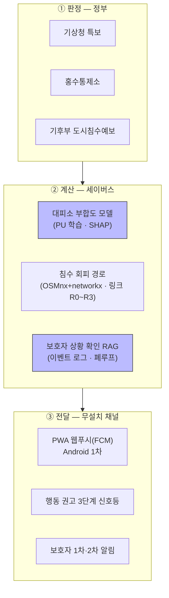
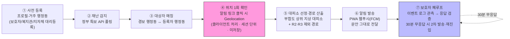
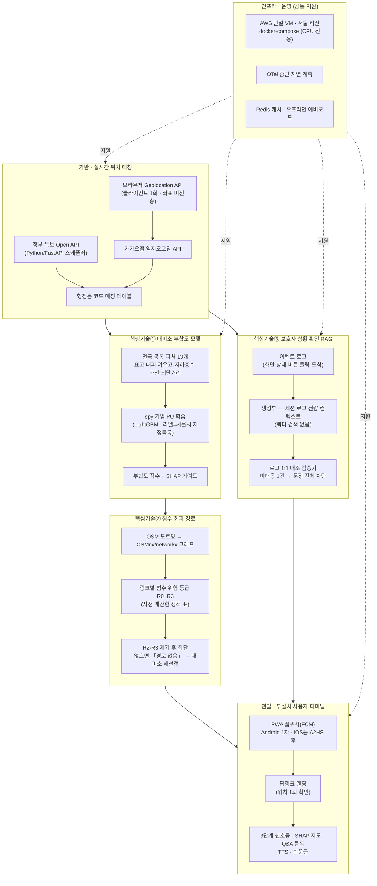
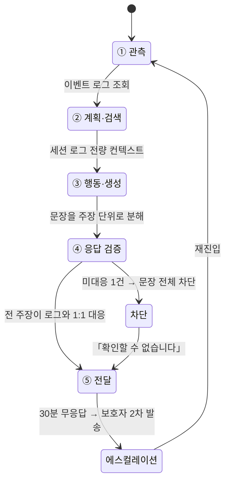
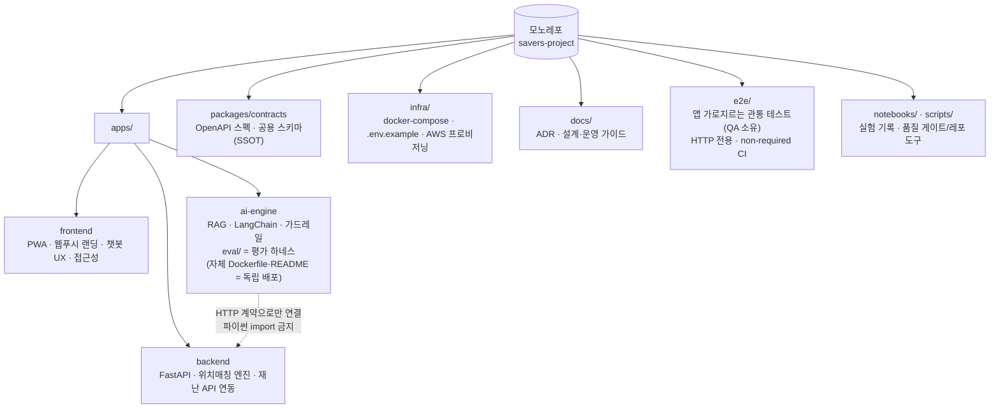

# 세이버스(SAVERS) 프로젝트 구조도

`AGENTS.md`, `개발자_가이드.md`, `리스크.md`, `구현_범위.md`와 **제출 기획서 v3(2026-08-10)** 를 바탕으로 시스템 구조를 mermaid로 도식화한 문서입니다.

> ⚠️ **이 문서는 "무엇을 만들 것인가"(목표 아키텍처)입니다.** 지금 저장소에서 실제로 도는 것은
> 그 일부이며, 외부 의존은 전부 오프라인 스텁입니다. **"지금 무엇이 돌아가는가"는
> [워킹_스켈레톤_설명.md](워킹_스켈레톤_설명.md)** 에 모듈·함수 단위로 정리돼 있고, 각 단계를 직접
> 돌려 확인하는 절차는 [워킹_스켈레톤_점검.md](워킹_스켈레톤_점검.md)에 있습니다. 두 문서가
> 어긋나면 코드와 대조해 이 문서를 갱신하세요.
>
> 알림 채널은 [ADR-0005](../adr/0005-webpush-primary-channel.md)로 **PWA 웹푸시(FCM) 1차**가
> 확정됐습니다(카카오 알림톡은 예선 범위 제외). 아래 도식은 그 결정을 반영한 상태입니다.

## 1. 3층 역할 분담 — 판정은 정부, 계산은 세이버스, 전달은 무설치 채널

기획서 v3의 층 구분입니다. **자체 경보 판단은 구현하지 않습니다** —
정부가 실시간 계측으로 공개하는 판정을 그대로 따르고, 세이버스는 그 판정을 「지금 무엇을 할지」로 바꿉니다.

## 2. 전체 파이프라인 (수신 → 발송 → 폐루프)

> 목표: ① ~ ⑥ 전 구간 종단 지연 30초 이내 (근거: [리스크.md](리스크.md) ③ 참고 — 실측으로 교체 대상).
> ⑦ 폐루프의 2차 발송 성공률 100%가 별도 지표입니다.

### 위치 취득 3단 분리 — 「저장하지 않는다」가 아니라 「받지 않는다」

| 단계 | 무엇을 | 저장 |
|---|---|---|
| 평시 등록 | 행정동만 | 저장 |
| 특보 발령 | 행정동 단위로 대상 선별 | 좌표 없음 |
| 알림 open | Geolocation 1회 취득 → 경로 계산 | 세션 종료 시 파기 |

**행정동 판정과 대피소 선정을 클라이언트에서 처리해 좌표 수신 엔드포인트를 없애는 것이 본선 목표 상태입니다**
(검토 중 — ADR 대기, [AGENTS.md](../../AGENTS.md) "Planned architecture" 표 1번).
정책 문구가 아니라 코드로 증명되는 구조이고, 그래서 「**위치정보 미수신**」 검증은
"지우는지"가 아니라 **"받지 않는지"** 를 확인하는 형태가 됩니다.

> ⚠️ 현재 계약([packages/contracts/openapi.yaml](../../packages/contracts/openapi.yaml))의
> `ShelterSearchRequest`에는 `lat`/`lng`가 아직 있습니다 — 제거 대상입니다.
> 선정을 클라이언트로 옮기면 서버가 맡던 안전 필터(호우·침수 시 지하 시설 제외, 계단 이용 불가자 정렬 —
> [워킹_스켈레톤_설명.md](워킹_스켈레톤_설명.md) 2-3절)도 함께 옮겨야 하며, 그 이관 설계가 같은 ADR에 들어갑니다.

## 3. 핵심 기술별 시스템 아키텍처

기획서 v3의 핵심 기술 셋과 계층별 기술 스택을 데이터 흐름 순서로 배치했습니다.

## 4. 보호자 폐루프 (에이전틱 5단계)

기획서가 「에이전틱」이라 주장하는 근거가 정확히 이 루프입니다.
한 번 묻고 끝나지 않고, **30분 무응답이면 관측으로 되돌아갑니다.**

검색 대상은 **그 세션의 이벤트 로그 전량뿐**이고, 로그 밖의 문서도 좌표도 없습니다.
챗봇은 로그를 풀어 쓸 뿐 안전 여부를 판단하지 않습니다 —
「안전합니다」·「괜찮습니다」는 금지어이고, 「무엇이 언제 눌렸다/안 눌렸다」 형태로만 답합니다.

## 5. 장애 시 폴백 — 안내는 멈추지 않되, 무엇이 대체된 값인지 드러냅니다

| 실패 지점 | 폴백 | 화면 표기 |
|---|---|---|
| 특보 API 중단 | Redis 캐시 | 데이터 기준 시각 표기 |
| 지오코딩·DEM 매칭 실패 | 등록 행정동 기준 | 「등록하신 동 기준」·「판정 불가」 |
| 로그 대조 검증 실패 | 최소안전문 | 「확인할 수 없습니다」 |
| 통과 가능한 경로 없음 | 대피소 재선정 | 「경로 없음」 |
| 통신 두절 | 내려받아 둔 대피소·행동요령 오프라인 모드 | 부합도는 정적 값 |

**모든 안내에 판단 시점과 데이터 기준 시각을 표기합니다**
(「기상청 특보 21:12 기준 / 대피소 정보 21:20 기준」).

## 6. 저장소(Repo) 구조 제안

역대 수상팀 GitHub 구조 조사(원본 PDF는 public 레포 밖 보관)의 본질적 결론(AI를 인라인 호출이 아닌 **독립 배포 가능한 엔진**으로 두고 배포·운영 문서를 함께 정리)을 반영하되,
소규모(접수 시 6인·현재 4인)·해커톤 단기·Tech Lead 초반 집중 조건을 고려해 **단일 모노레포**로 운영합니다. AI(`apps/ai-engine`)는 모노레포 안에서 자체 Dockerfile·README로 독립 배포 가능한 엔진으로 유지합니다. (근거: [개발자_가이드.md](개발자_가이드.md) 7절, [ADR-0001](../adr/0001-monorepo.md))

> 앱 간 결합은 `packages/contracts`의 HTTP 계약으로만 허용합니다. `apps/backend`와 `apps/ai-engine`이 서로를 파이썬 import 하는 순간 "독립 배포 가능한 AI 모듈"이라는 구조의 근거가 사라집니다.
> `e2e/`에도 같은 제약이 적용됩니다 — 관통 테스트는 기동된 서비스에 HTTP로만 접근하며, 앱 패키지를 import하지 않습니다.

## 7. 참고 문서 연결

- **지금 실제로 도는 코드 경로**: [워킹_스켈레톤_설명.md](워킹_스켈레톤_설명.md) (모듈·이음매·교체 지점)
- **단계별 동작 확인 절차**: [워킹_스켈레톤_점검.md](워킹_스켈레톤_점검.md) (명령 → 기대 출력 → 통과 기준)
- 각 모듈의 직접 구현 vs 외부 대체 범위: [구현_범위.md](구현_범위.md)
- 구조 설계 시 유의해야 할 리스크: [리스크.md](리스크.md)
- 팀 구성 및 비개발 배경 설명: [개발자_가이드.md](개발자_가이드.md)
- 역할별 실행 매뉴얼(누가·무엇을): [역할_가이드/](../역할_가이드/README.md)
- 시간축 실행 계획(언제·마일스톤·페이즈): [역할_일정/](../역할_일정/00-overall.md)
- 외부 승인·리드타임 체크리스트: [외부_승인.md](외부_승인.md)
- Claude Code 작업 시 기준 문서: [../../CLAUDE.md](../../CLAUDE.md)
