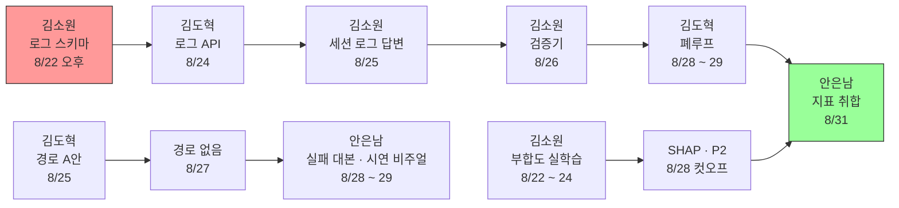

# 전체 통합 타임라인 — 본선까지 (8/22 ~ 9/2)

전 역할의 작업을 하나의 시간축에 얹은 문서입니다.
개별 역할의 상세는 [01 ~ 04 개별 타임라인](README.md#문서-목록)을, 기준 날짜·4대 지표 프레임은 [README.md](README.md)를 보세요.

- **구현** 8/22 ~ 8/29 (**7일**) · **코드 프리즈** 8/29(토) · **리허설** 8/31 ~ 9/1 · **본선** 9/2(수) ~ 9/3(목) · **시상식** 9/4(금)
- **8/22(토)는 오후 4시간뿐**입니다 — 오전은 Tech Lead 하네스 작업 구간. 구현 창구는 **52시간**입니다.
- **일요일(8/23·8/30)은 휴무**입니다. 단 **8/23은 전시월 마감일이라 PM만 예외 작업**합니다.
- **PM 실무는 9/1까지**이고 9/2는 발표 준비만 합니다.
- 팀 구성 (4인) — 안은남(PM·QA·인프라) · 신호정(Tech Lead, 설계·계약 전담) · 김소원(AI 모델·RAG·FE) · 김도혁(Backend)

---

## 0. 일요일 휴무의 대가 — 사흘이 사라졌습니다 ★ 먼저 읽으세요

이전 계획은 **8/21 ~ 8/30 열흘**을 구현 구간으로 잡았고, 그 열흘에 정확히 열흘치가 들어 있었습니다.
**작업 구간을 8/22 ~ 9/2로 확정**하고 일요일 둘(8/23·8/30)을 쉬면 실제 구현일은 **7일**이 됩니다.
8/21(금)에는 아무것도 배정하지 않습니다.

| | 이전 | 지금 | 차이 |
|---|---|---|---|
| 작업 구간 | 8/21 ~ 9/2 | **8/22 ~ 9/2** | 8/21 배정 없음 |
| 구현 구간 | 8/21 ~ 8/30 | **8/22 ~ 8/29** | |
| 실제 작업일 | 10일 | **6.5일** | **−3.5일** |
| 구현 창구 | 80h | **52h** | **−28h** |
| 코드 프리즈 | 8/30(일) | **8/29(토)** | 하루 당김 |
| 제출본 마감 | 8/23(일) | **8/22(토) 완성** | 8/23이 휴무 |

**세 사람 모두 창구에 거의 닿습니다.** 그래서 **버릴 것을 미리 정하고 자를 시각까지 못박아 두었습니다.**

### 8/22 반나절의 값 — 조건부가 3건에서 1건으로 줄었습니다

8/22 오전이 하네스 작업 구간이 되면서 **세 사람이 4시간씩, 12시간이 빠졌습니다**(창구 56h → 52h).
그 12시간이 정확히 조건부 항목에서 나갔습니다.

| 조건부였던 것 | 이전 | 지금 |
|---|---|---|
| 「기타」 자유질문 (소원 4h) | 컷오프 8/27 | **지금 뺍니다** — 슬랙이 4h뿐이라 SHAP과 둘 다는 불가 |
| SHAP 기여도 (소원 4h) | 컷오프 8/28 | **유지** — 컷오프 8/28 저녁 |
| OSRM B안 (도혁 8h) | 판정 8/28 18:00 | **창구 밖** — 버퍼 6h에 8h가 안 들어갑니다. 본선 이후. ⚠️ 2026-08-28 CCTV 제거로 버퍼는 9.5h가 됐으나 8/29에 실제로 남는 것은 3.5h뿐이라 8h는 여전히 안 들어갑니다 — 판정 시각(8/28 18:00) 경과로 [04-백엔드.md §3](04-백엔드.md#3-osrm-b안--이번-구간에서-뺍니다-본선-이후)에서 8/29 프리즈 자동 소멸로 종결 |

**자유질문을 먼저 뺀 이유** — 추천 3질문 + 「확인할 수 없습니다」 폴백만으로도
「근거 없으면 답하지 않는다」는 구조가 증명됩니다. SHAP은 시연 하이라이트라 대체가 없습니다.

**OSRM을 조건부로도 안 남긴 이유** — 폐루프(P0)와 같은 이틀을 쓰는데 버퍼가 6h라
남겨 두면 P0를 잡아먹습니다. 기획서 주장(OSM 도로망을 그래프로 올려 침수 위험 링크 제외)은
**A안(OSMnx + networkx)으로도 그대로 성립**하므로 발표에는 지장이 없습니다.

### 압축은 「선제 컷」이 아니라 「조건부 + 컷오프 시각」입니다

작전판 방식을 그대로 따릅니다 — **P2 항목을 미리 자르지 않고 남겨 두되, 컷오프 시각을 못박습니다.**
잘 풀리면 기획서 문구를 그대로 지킬 수 있고, 안 되면 **그 시각에 그 자리에서** 자릅니다.
「나중에 보고 판단」이 아니라 **날짜와 시각이 정해져 있다**는 것이 핵심입니다.

| 조건부 항목 | 담당 | 시간 | 컷오프 | 자를 때 대신 |
|---|---|---|---|---|
| **SHAP 기여도** | 김소원 | 4h | **8/28 저녁** | 대표 3곳 고정 카드. 8/29는 시연 화면 8h가 하루를 다 씁니다 |

**남은 조건부는 이것 하나뿐입니다.** 자유질문과 OSRM은 위 §0에서 이미 뺐습니다.
컷오프에서 자를 때는 그 자리에서 PM에게 통보합니다 — 발표 대본과 [표3] 문구가 달라집니다.
**판정은 PM(안은남)이 합니다.** 구현자는 자기가 만든 것을 자르기 어렵고,
자를 때 달라지는 것(발표 대본·[표3] 문구·지표 취합)이 전부 PM 소관이기 때문입니다.
**8/27 예비 하루를 들고 있는 사람도 PM**이라, 「자를까 / 받아줄까」를 같은 자리에서 정할 수 있습니다.

### 이미 확정적으로 옮긴 것 (조건부 아님)

| 옮긴 것 | 누구 | 효과 |
|---|---|---|
| **시연 환경 배포·롤백·현장 인프라 6h** | 김도혁 → 안은남 | 인프라가 PM 소관이 되어 자연스럽습니다 |
| **신호등 3단계 UI 4h** | 김소원 → 안은남 | 프런트엔드는 소원 님 소관이지만 **버퍼가 0**이라 넘겼습니다 |
| **시연 화면 비주얼·문구 8h** | 김소원 → 안은남 | 은남 님이 비주얼·문구, 소원 님이 데이터 연결 |

### 인당 부하 — 세 사람 모두 창구에 거의 닿아 있습니다

| 담당 | 확정 | 조건부 | 합계 | 창구 | **버퍼** |
|---|---|---|---|---|---|
| **김소원** | 48h | 4h (SHAP) | 52h | 52h | **0h** |
| **김도혁** | 42.5h | — | 42.5h | 52h | **9.5h** |
| **안은남** | 49.5h | — | 49.5h | 52h | **2.5h** |

**버퍼가 사실상 사라졌다가 일부 돌아왔습니다.** 이전에는 PM이 7.5h를 들고 「막히는 사람을 받는 자리」였는데,
8/22 반나절과 전시월 8.5h 이월로 **0.5h**까지 줄었습니다. 그 뒤 PR #90·#76이 main에서 이미 머지·CI 연결까지
끝나 있던 것이 확인되며 배정에서 2h가 빠져, **2.5h**로 돌아왔습니다(2026-08-22, [역할_일정/01-기획총괄.md §1](01-기획총괄.md)).
남은 완충은 **2.5h**·**PM의 8/27 예비 하루**와 **도혁 님 9.5h**, 그리고 **8/30(일) 최후 수단**입니다.
**도혁 님 몫은 2026-08-26에 6.5h에서 6h가 됐습니다** — 보호자 기기 갱신을 교체로 바꾸는 0.5h가
8/28에 들어갔고([ADR-0015](../adr/0015-guardian-device-registration.md) 결정 4번), 그만큼 8/29 여유가 줄었습니다.
**2026-08-28 갱신 — CCTV 3.5h를 빼며 6h → 9.5h가 됐습니다.** 사유는 §4를 보세요.
리허설 창구 16h(8/31 ~ 9/1)는 세 사람 모두 별도이며, **여기에 개발을 밀어 넣지 마십시오** —
리허설에서 반드시 문제가 나오고, 그걸 고칠 시간이 그 16h입니다.

### 8/30(일)은 예비일입니다

쉬는 날이지만 **비워 둔 날**이기도 합니다.
8/29 저녁에 프리즈가 안 되면 8/30 반나절을 쓰는 것이 리허설을 깎는 것보다 낫습니다.
**계획에는 넣지 않되, 최후 수단으로 남겨 둡니다.**

---

## 1. 구간별 전 역할 매트릭스

### 1구간 · 제출과 스펙 — 8/22(토) ~ 8/24(월)

| 담당 | 8/22(토) **오전** | 8/22(토) **오후 4h** | 8/23(일) | 8/24(월) |
|---|---|---|---|---|
| **안은남** (PM·QA·인프라) | — | ✅ PR #90 머지 완료(사전) · **전시월·보도자료 착수(3.5h)** | **예외 2h — 전시월 마무리·제출** | **ADR 승인(1h)** · 신호등 UI(4h) · 발표 골격(3h) |
| **신호정** (Tech Lead) | **하네스 작업** · PR #95 머지 | **이벤트 로그 스키마 리뷰** | 휴무 | **보호자 Q&A 계약(오전)** · **검증기·폐루프 스펙(오후)** |
| **김소원** (AI·RAG·FE) | — | **이벤트 로그 스키마 초안 → 확정(3h)** · 부합도 착수(1h) | 휴무 | **부합도 실학습 완료(7h)** · 추천 3질문 착수 |
| **김도혁** (Backend) | — | **FCM ① 실기기 도달(3.5h)** | 휴무 | **이벤트 로그 저장·조회 API(8h)** |

**이 구간이 끝날 때 반드시 되어 있어야 할 것**

- **전시월·보도자료 제출 완료** — 8/23이 휴무이므로 8/22에 끝내야 합니다
- **이벤트 로그 스키마 확정** — **8/22 오후 4시간 안에.** 전체의 단일 출발점
- **FCM으로 실기기에 푸시 도달** — 두 지표(도달 30초·2차 발송 100%)의 전제
- **로그 저장·조회 API 동작** · **부합도 모델 2겹 수치** (미달이어도 무방, **아는 것**이 중요)
- **Tech Lead 스펙 3건 전달 완료** — 스키마·Q&A 계약·검증기 규칙. 8/22에 하나, 8/24에 둘

> **8/22 오후엔 스키마 리뷰 하나만 들어갑니다.** 8/22 오전은 신호정 님의 하네스 작업 구간이라
> 비어 있지 않고(하네스 작업 + PR #95 머지), 스키마 확정(김소원, 3h)과 그 리뷰(신호정)가
> 같은 4시간 안에서 순서대로 이어져야 하므로 **여기에 다른 스펙을 더 넣지 않습니다.**
> **Q&A 계약은 8/24 오전, 검증기·폐루프 스펙은 8/24 오후**입니다 — Q&A 계약이 김소원의
> 추천 3질문(8/24~25) 착수보다 먼저 나와야 하므로 8/24 오전이면 늦지 않습니다.
> 상세 근거는 [02-테크리드.md "날짜가 그 자리에 있는 이유"](02-테크리드.md#날짜가-그-자리에-있는-이유)를 보세요.

> **ADR 승인이 8/22 → 8/24로 이동했습니다.** 8/22가 제출본으로 꽉 차기 때문이고,
> 8/26 인프라 인수 전이기만 하면 되므로 8/24로도 늦지 않습니다.

### 2구간 · 구현 집중 — 8/25(화) ~ 8/29(토) · **8/29 프리즈**

> **2026-08-27 갱신 — 8/29 김도혁 몫에 2.5h가 추가로 들어갑니다.**
> 보호자 1차 알림을 사용자와 동시 발송하는 결정이 팀에서 정해져(별도 신규 이벤트로 구현)
> 여유 6h → 3.5h로 줄었습니다. 상세는 [04-백엔드.md](04-백엔드.md)를 보세요.

| 담당 | 8/25(화) | 8/26(수) | 8/27(목) | 8/28(금) | 8/29(토) |
|---|---|---|---|---|---|
| **안은남** | **M3 증거 — 시험 PR 실행 확인(0.5h)** · 신호등 UI · #25 노출 차단 | **인프라 인수 — 본인 SSM 접속 확인 + 단독 배포 1회** | #84 잠금 테스트 · #77 폴백 문안 · 골든셋 「기타」 10건 · **예비(팀 지원)** | **실패 모드 대본 5종(4h)** · **시연 화면 비주얼(8h 중)** | **시연 화면 비주얼 완료** · **시연 환경 배포(단독 3h)** · 위치정보 무저장·무로깅 확인·p95 측정 |
| **신호정** | · | · | 통합 리뷰 — 생성·검증·로그가 계약대로 붙었는지 | · | 가드레일 임계값 판정 · **코드 프리즈 선언** |
| **김소원** | 추천 3질문 3h · **세션 로그 답변 5h** | **세션 로그 답변 3h · 검증기 5h** | **검증기 3h** · 폴백 2h · SHAP P2 3h | 보호자 화면 + Q&A UI 7h · **SHAP P2 1h (컷오프 저녁)** | **시연 사용자 화면 5종 8h** |
| **김도혁** | FCM ② 2차 발송 4.5h · **경로 A안 3.5h** | **경로 A안 2.5h · FE↔BE 5.5h** | **FE↔BE 2.5h** · 「경로 없음」 4h | **폐루프 ① 6.5h** | **폐루프 ② 1.5h** · **보호자 1차 알림 추가 2.5h**★(8/27 결정) · 여유 3.5h |

**이 구간이 끝날 때 반드시 되어 있어야 할 것**

- **킬러 데모 한 바퀴** — 특보 → 신호등 → 대피소·부합도 → 회피 경로 → 보호자
- **보호자가 물으면 로그 근거로 답하고, 없으면 「확인할 수 없습니다」**
- **폐루프가 30분 뒤 스스로 되돌아온다** — 「에이전틱」 주장의 유일한 증거
- **실패 모드 5케이스 재현** · **코드 프리즈 + 시연 환경 배포**(8/29)

### 3구간 · 리허설과 본선 — 8/31(월) ~ 9/2(수)

| 담당 | 8/31(월) | 9/1(화) | 9/2(수) |
|---|---|---|---|
| **안은남** | **4대 지표 취합표 · 시연 캡처 세트 · 리허설 ①** | 리허설 ②③ · **롤백 1회 실제 실행** · 발표자료 확정 | 발표 준비만 |
| **신호정** | 리허설 기술 지원 · Q&A 예상질문 정리 | 시연 환경 최종 확인 | 현장 기술 점검 · Q&A 방어 대기 |
| **김소원** | 리허설 지원 · 데모 시연 연습 | 데모 최종 점검 · 시연 연습 | 현장 데모 최종 점검 |
| **김도혁** | 리허설 인프라 지원 · 현장 네트워크 대비 | `/mockup` 백업 확인 | **현장 인프라 실행 대응** (판단은 PM) |

**이 구간이 끝날 때 반드시 되어 있어야 할 것**

- **4대 지표가 목표치가 아니라 실측값으로 교체** — 미달은 실패 사례로 기재
- **리허설 3회** — 실패 모드 시연까지 포함한 전체 흐름
- **롤백을 실제로 한 번 해봄** — 문서만 있고 안 해봤으면 본선에서 못 씁니다

---

## 2. 임계 사슬 셋

각 사슬의 첫 칸이 하루 밀리면 마지막 칸도 하루 밀립니다.

**임계경로가 김소원과 김도혁을 번갈아 지납니다.** 한쪽이 밀리면 반대쪽이 대기하므로,
Tech Lead 스펙 3건(8/22 하나·8/24 둘)이 먼저 내려와야 합니다.

## 3. 핸드오프 — 넘기는 날짜가 곧 마감입니다

| 넘기는 사람 | 받는 사람 | 무엇을 | 언제까지 | 못 받으면 막히는 것 |
|---|---|---|---|---|
| **김소원** | 김도혁·신호정 | **이벤트 로그 스키마** | `8/22 오후` | Tech Lead 리뷰(당일)·로그 API(8/24)·세션 로그 답변(8/25)이 전부 여기서 출발합니다. **전체의 단일 출발점** |
| **신호정** | 전원 | 보호자 Q&A 계약 (OpenAPI) | `8/24 오전` | 「검색 대상은 그 세션 로그 전량, 세션을 넘지 않는다」를 못박아야 범위가 흔들리지 않습니다. 김소원의 추천 3질문 착수(8/24)보다 먼저 나와야 합니다 |
| **신호정** | 김소원·김도혁 | 검증기 규칙 · 폐루프 로직 스펙 | `8/24` | 검증기(8/26 ~ 27)와 폐루프(8/28 ~ 29). 구현자가 설계까지 하면 반드시 어긋납니다 |
| **김도혁** | 김소원 | 이벤트 로그 저장·조회 API | `8/24` | 세션 로그 답변(8/25). 저장이 없으면 읽을 것이 없습니다 |
| **김소원** | 김도혁 | **대조 검증기** | `8/27` | 폐루프의 4번째 칸입니다. 이게 없으면 8/28에 조립할 것이 없습니다 |
| **김도혁** | 안은남 | 「경로 없음」 재선정 동작 | `8/27` | 실패 모드 대본(8/28)의 네 번째 케이스 |
| **김소원** | 안은남 | 부합도 수치 · [표3] 교체본 | `8/29` | 지표 취합(8/31) |
| **안은남** | — | **시연 환경 배포 (단독)** | `8/29` | 리허설 8/31 ~ 9/1. 8/30이 휴무이므로 프리즈 당일에 끝내야 합니다 |
| **신호정** | 전원 | 코드 프리즈 · 시연 브랜치 | `8/29` | 이후 기능 추가 금지, 시연 경로 버그 수정만 |

## 4. 안 하기로 한 것

적어두지 않으면 나중에 「왜 빠졌지」로 돌아옵니다.

| 항목 | 담당 | 이유 | 대신 어떻게 |
|---|---|---|---|
| **OSRM 엔진** | 김도혁 | 8/22 반나절로 창구 밖(8h > 버퍼 6h) | **OSMnx + networkx.** 기획서에 「OSRM」이 두 번 적혀 있으므로 **제출본에 정정 표기 필수** — [서비스_기획서.md](../공유_문서/서비스_기획서.md) 맨 앞 |
| **「기타」 자유질문** | 김소원 | 슬랙 4h로 조건부 1건만 가능 | 추천 3버튼 + 「확인할 수 없습니다」 폴백 |
| 부합도 검증 4겹 → **2겹** | 김소원 | 압축 | ① 공간 블록 CV + ② 비학교 recall@top-20%. [표3]에 2겹 기준임을 명시 |
| 목업 비주얼 통일 (`tokens.ts`) | 김소원 | 압축 | 기존 화면 디자인 그대로. 본선 후 |
| 시연 캡처 | 김소원 → 안은남 | 김소원 버퍼 0 | PM 8/31 |
| 신호등 UI·시연 비주얼 (12h) | 김소원 → 안은남 | 김소원 버퍼 0 | PM 8/24 ~ 25 · 8/28 ~ 29 |
| 서비스 소개·사전등록 페이지 정리 | 김소원 | 시연에 나오지 않음 | 기존 화면 그대로 |
| 기존 사용자 화면 재구성 | 김소원 | 고치면 24h, 새로 쓰면 8h | **시연 전용 라우트를 새로 씀.** 기존 화면은 손대지 않음 |
| 행동요령 RAG 파이프라인 삭제 | 김소원 | 지우는 것도 공수 | 방치하고 언급하지 않음 |
| **CCTV 시연 화면 표시** (3개소 고정 주소로 축소했던 항목 전체) | 김도혁 → 안은남 | 2026-08-28 PM 판정 — 8/21 논의 이후 별도 확정 없이 남아 있던 항목이었고(도혁 확인 결과 실작업 근거 없음), 시연 우선순위상 제외 | 시연 화면에 CCTV 자리를 두지 않음. 도혁 님 3.5h(실측 0.5h + API 3h) 회수 — §1 인당 부하 표 갱신. (0절에 남아 있던 「CCTV 6h」 행은 축소 전 표기이며 이 PR에서 삭제 — 일자별 실제 배정은 3.5h였습니다) |
| p95 계측 스크립트 별도 인계 | 김도혁 → 안은남 | 기존 OTel 계측을 PM이 그대로 실행 | PM 8/29 |
| 외국인 근로자 다국어 데모 | (전 Frontend/UX) | 페르소나 1인(반지하 고령자)으로 좁힘 | 발표에서 B2B 확산 단계로 |
| 16개 시·도 적용 지도 | 김소원 | 취소 | 발표 서술로만 |
| 세션을 넘는 시계열 질의 | 김소원 | 「평소에도 이랬나요」 — 이것만 인덱싱이 필요 | 「확인할 수 없습니다」로 폴백 |
| 실시간 통제 정보(UTIC) 연동 | 김도혁 | 본선 이후 로드맵 | 붙이면 네이버 지도와 같은 층에서 겨루게 되는데 우리 차별점이 아님 |

## 5. 이 계획의 위험

### ① 8/22 오후 로그 스키마 — 4시간 안에 끝나야 합니다

반나절 늦으면 로그 API가 8/25로, 세션 로그 답변이 8/26으로, 검증기가 8/27로 밀려 **폐루프가 프리즈를 넘깁니다.**
반나절이 이틀이 되는 구조입니다.

8/21에 배정이 없어지면서 **초안을 미리 올려 둘 하루가 사라졌습니다.**
따라서 8/22는 **초안 작성과 확정을 오후 4시간 안에 함께** 해야 합니다.
완화책은 하나뿐입니다 — **범위를 미리 좁혀 두는 것.**
기존 `SessionStore`에 `events` 배열을 얹는 형태이고 **신설이 아니며**,
필드는 `type` · `at` · `payload` 셋을 넘기지 않습니다.
설계를 열어 놓고 논의를 시작하면 **4시간 안에 끝나지 않습니다.**
같은 오후에 Tech Lead 리뷰까지 받아야 합니다.

### ② 완충이 거의 없습니다

8/22 반나절로 12시간이 빠지면서 **조건부 3건이 1건으로 줄었고, PM 버퍼가 7.5h → 0.5h가 됐습니다.**
그 뒤 PR #90·#76이 main에서 이미 끝나 있던 것이 드러나며 배정에서 2h가 빠져 **0.5h → 2.5h로 돌아왔습니다**
(2026-08-22, [역할_일정/01-기획총괄.md §1](01-기획총괄.md)) — 완전히 사라진 상태는 아니지만 여전히 얇습니다.

남은 완충은 넷입니다 —

| 완충 | 크기 | 성격 |
|---|---|---|
| PM **버퍼** | 2.5h | PR #90·#76 선행 완료로 회수됨 |
| PM **8/27 예비** | 하루 | 막히는 사람을 받는 자리 |
| 김도혁 **버퍼** | 9.5h | 8/29 오후에 몰려 있음 (CCTV 제거로 2026-08-28 갱신) |
| **8/30(일)** | 반나절 | 최후 수단. 계획에 넣지 않음 |

**김소원 님은 완충이 0입니다.** 8/22 오후·8/24 두 칸 중 하나라도 밀리면
**SHAP(마지막 조건부)이 자동으로 날아갑니다.**

### ③ 8/22에 넷이 겹칩니다 — 작업 구간의 첫날이 가장 무겁습니다

제출본 완성(PM) · 스키마 초안+확정(김소원) · FCM 실발송(김도혁) · 스키마 리뷰(신호정).
**토요일 하루에 팀 전체의 출발점이 몰려 있고, 그 앞에 완충일이 없습니다.**

각자 8시간 안에 들어가는지 따져보면 이렇습니다.

| 담당 | 8/22 배정 | 8h 안에? |
|---|---|---|
| 안은남 | 전시월·보도자료·사전설문 (PR #90은 사전 머지 완료) | **빠듯함** — 아래 |
| 신호정 | 하네스 작업(오전) + PR #95 리뷰·머지(오전) + 스키마 리뷰(오후) | 여유 |
| 김소원 | 스키마 초안+확정(오후) + 부합도 착수(오후) | 맞음 |
| 김도혁 | FCM 실발송 + 2차 발송 경로 | **빠듯함** |

**PM 쪽이 되는 이유**는 [보도자료 확정원고와 전시월 원고가 이미 나와 있기 때문](../공유_문서/)입니다.
8/22에 남은 것은 **서식에 옮겨 담고 4인 교차검토 1회를 도는 것**이라 12시간이 아니라 5 ~ 6시간짜리입니다.
**원고가 아직이라면 8/22 안에 끝나지 않습니다** — 그때는 ADR 승인처럼 미룰 수 있는 것이 없으므로
8/23 오전에 제출 검토용으로 1 ~ 2시간만 예외로 쓰는 것을 계획에 넣으십시오.

**Backend 쪽**은 이전 계획에서 8/21 ~ 22 이틀이던 FCM이 하루로 붙은 결과입니다.
실기기 도달까지 못 가면 **2차 발송 경로를 8/24 로그 API 뒤로 미루고**, 실발송 하나만 8/22에 끝내십시오.

### ④ 8/29에 셋이 겹칩니다

김소원의 마지막 구현 · PM의 시연 배포 · Tech Lead의 코드 프리즈.
**구현이 끝나는 날에 얼려서 배포까지 합니다.**
8/28 저녁에 상태를 보고 8/29 몫 중 못 끝낼 것이 보이면 그날 잘라냅니다.

### ⑤ 본선 당일 인프라 — 소유는 PM, 실행은 Backend

PM은 무대에 있어 발표 15분 동안 서버를 볼 수 없습니다.
그래서 8/26 인수를 **PM이 혼자 해보고**, 9/1에 롤백을 **실제로 한 번** 해봐야 합니다.
셸 권한 3인(김도혁·신호정·안은남)이 이것을 전제로 합니다([ADR-0009](../adr/0009-ssm-session-manager.md) 2026-08-26 개정).

## 6. 여유 시간 대기 목록 — 남으면 이 순서로 ★

52시간은 **막히고 다시 하는 시간까지 포함한 실소요**로 잡은 값입니다.
절반 만에 끝나는 항목이 있으면 그만큼이 남습니다. **남는 시간을 무엇에 쓸지 미리 정해 둡니다.**

> ### 규칙 둘
>
> 1. **8/27 저녁에 PM이 한 번만 판단합니다.** 각자 알아서 추가하지 않습니다.
>    8/28 ~ 29는 폐루프 조립·시연 화면·배포가 겹치는 이틀이라, 여기에 뭘 더 넣으면 **프리즈가 8/29에 안 됩니다.**
> 2. **리허설 창구 16시간(8/31 ~ 9/1)은 손대지 않습니다.** 리허설에서 반드시 문제가 나오고, 고칠 시간이 그 16시간입니다.

### 왜 「기능 추가」가 1순위가 아닌가

심사는 **얼마나 많이 했나**가 아니라 **주장한 것이 사실인가**를 봅니다.
기획서에 4대 지표와 검증 4겹을 이미 약속해 두었고, 지금 그중 상당수가 **「아직 측정 전」** 상태입니다.
여기에 기능을 얹으면 **증명해야 할 것만 늘어납니다.**
그리고 늦게 들어간 기능은 리허설에서 터지는데, 그때는 고칠 시간이 없습니다.

### 1순위 — 증거를 두껍게 (같은 시간에 점수가 가장 많이 오릅니다)

| 항목 | 담당 | 시간 | 왜 |
|---|---|---|---|
| **`summary.json` 레포 커밋** | 김소원 | **30분** | PU 실행 결과(P=73 / RN=504 / baseline 0.1353%)가 **커밋 메시지 산문에만 있고 파일이 없습니다.** `.gitignore:131`의 `/outputs/`가 디렉토리째 막고 있는데, git은 제외된 디렉토리 **안쪽**의 예외를 복원하지 못하므로 `!` 한 줄로는 안 됩니다. 파일을 `/outputs/` 밖(예: `apps/ai-engine/eval/`)으로 옮기고 기존 화이트리스트 패턴(`!apps/ai-engine/eval/**/*.jsonl` 등)에 얹으십시오. **시간이 남지 않아도 하십시오** |
| 부합도 검증 3겹째 (V3 lift) | 김소원 | 4h | 지금 2겹입니다. 침수예상도 baseline 대비 lift를 더하면 「랜덤보다 나은 거 맞나요?」에 숫자로 답할 수 있습니다 |
| **e2e 브라우저 테스트 1개** | 김소원 | 3h | **프론트 자동 테스트가 0건**입니다. Playwright는 설치돼 있고 CI가 `playwright install chromium`까지 하는데 테스트가 없습니다. **킬러 데모 흐름 하나만** 잡아도 시연 안정성이 크게 오릅니다 |
| 골든셋 확장 | 김소원 · 안은남 | 2 ~ 4h | 현재 6건. 검증기 케이스를 보태면 M2(「로그에 없는 사실 0건」) 신뢰도가 올라갑니다 |

### 2순위 — 잘라낸 것 되살리기

| 항목 | 담당 | 시간 | 되살릴 조건 |
|---|---|---|---|
| **OSRM B안** | 김도혁 | 8h | **8/28 18:00에 폐루프가 끝나 있으면.** 팀 전체에서 **가장 값어치 있는 복구**입니다 — 기획서 문구(OSM+OSRM)를 그대로 지킬 수 있게 되고 [정정 항목](../공유_문서/서비스_기획서.md) 하나가 사라집니다. 도혁 님 버퍼가 9.5h(2026-08-28 CCTV 제거로 갱신)로 가장 크므로 현실적으로 가능성이 가장 높습니다 |
| 「기타」 자유질문 | 김소원 | 4h | **8/27 검증기가 하루 일찍 끝나면.** 이미 설계돼 있고, Q&A 계약에 「그 외 입력은 폴백」이 명시돼 있어 **계약을 다시 쓸 필요가 없습니다** |
| SHAP 지도 클릭 인터랙션 | 김소원 | +2h | 고정 카드 3장 → 클릭으로 승격. 시연 하이라이트가 한 단계 올라갑니다 |

### 3순위 — 정말 남으면

| 항목 | 담당 |
|---|---|
| 보호자 화면 접근성 보강 | 김소원 (`readability.ts` 1,077줄이 이미 있어 붙이는 수준) |
| 목업 비주얼 통일 (`tokens.ts`) | 안은남 |
| **AWS 루트 계정 IAM 분리** · **Firestore 인증** | 안은남 — 기능은 아니지만 **보안 슬라이드가 두꺼워집니다** |

### 되살리면 안 되는 것

| 항목 | 왜 |
|---|---|
| 사용자 모바일 FE **재구성** | **24h짜리입니다.** 시간이 남아도 이건 아닙니다. 시연 전용 라우트(8h)로 갑니다 |
| 실시간 통제 정보(UTIC) 연동 | 붙이면 **네이버 지도와 같은 층에서 겨루게 됩니다.** 우리 차별점이 아닙니다 |
| 서비스 소개·사전등록 페이지 정리 | 시연 흐름에 나오지 않습니다 |
| 16개 시·도 적용 지도 · 다국어 데모 | **검증할 수 없는 주장이 늘어납니다** |
| M3 파기 루프 | 문구를 「위치정보 무저장·무로깅」으로 바꿨으므로(좌표를 애초에 저장하지 않음) **불필요해졌습니다** |

## 7. 참고

- 각 작업의 "왜 이게 이 역할인가"는 [역할_가이드/](../역할_가이드/)를,
  리스크는 [리스크.md](../공통_가이드/리스크.md)를, 승인 항목은 [외부_승인.md](../공통_가이드/외부_승인.md)를,
  지금 코드에 무엇이 있는지는 [공유_문서/기존_자산_내역.md](../공유_문서/기존_자산_내역.md)를 함께 보세요.
- 근거 — 제출 기획서(2026-08-10) [표7]·[그림8]·핵심기술③ · 파트 분배 제안(2026-08-11) ·
  보호자 RAG 구현 스펙 · 이벤트 로그 API 스펙 · 본선 작전판(2026-08-21).
