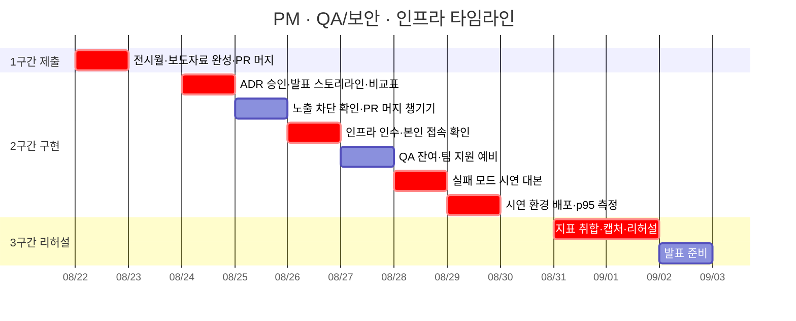

# PM · QA/보안 · 인프라 개별 타임라인

담당: 안은남 · 역할 정의: [역할_가이드/01-기획총괄.md](../역할_가이드/01-기획총괄.md) ·
전체 흐름: [00-overall.md](00-overall.md) · 기준 날짜: [README.md](README.md)

네 갈래(PM·QA·인프라·실험)를 한 사람이 가지므로, 이 타임라인의 원칙은 **겹치지 않게 배치**하는 것입니다.
Backend의 시간을 쓰는 항목(인프라 인수)은 Backend가 여유 있는 날에 붙이고, 발표 관련은 주말에 붙였습니다.
**PM 실무는 9/1까지**이고 9/2는 ⚠️정정(2026-09-01, ADR-0019 정정 제안) — ~~발표 준비만~~
**현장 인프라 실행 대응** 합니다(본선 발표자는 김도혁, §8 참고).

> **2026-08-21 갱신 — 작업 구간 8/22 ~ 9/2 확정 · 일요일 휴무 반영.**
> 인당 가용을 평일·토요일 8시간, **일요일 0시간**으로 정했고, **8/21(금)에는 배정하지 않습니다.**
> 8/23과 8/30이 일요일인데 하필 그 이틀이 **제출 마감일**과 **코드 프리즈일**이었습니다.
> 제출본은 **8/22(토)에 완성**하고, **코드 프리즈를 8/29(토)로 당깁니다.**
> 8/31에 프리즈하면 리허설이 9/1 하루뿐이라 리허설에서 나온 문제를 고칠 시간이 없어집니다.
>
> **8/21 몫이 사라지면서 이 포지션이 가장 크게 영향받습니다.** 두 가지를 조정했습니다.
> ① 8/22가 **오후 4시간**뿐이라 전시월 8.5h가 8/23으로 넘어갑니다 — 3절.
> ② **ADR-0008·0009 승인을 8/22 → 8/24로 옮겼습니다** — 8/26 인프라 인수 전이면 되므로 늦지 않습니다.

## 0. 착수 전 (8/22 이전, 배정 없음) — 팀이 8/22에 바로 코드에 붙을 수 있도록

작업 구간은 **8/22부터**입니다. 아래는 일정에 잡힌 작업이 아니라, 8/22가 막히지 않기 위한 **선행 정리**입니다.
전부 못 해도 되지만, **골든셋 초안은 8/22 오전을 좌우합니다.** (PR #90은 사전 머지 완료)

| 항목 | DoD | 안 하면 |
|---|---|---|
| CODEOWNERS 4인 갱신 (`/infra/`·프론트 오너 포함) | 4인 기준 소유자 매핑 | ✅ **PR #90에서 처리 완료**(`ee4a7b3`) — `/docs/adr/`가 2인 → 3인이 되어 ADR 승인 PR이 한 사람만 기다리는 상태를 피함 |
| 운영사무국 재통보 (6인 → 4인)·참가서약서 원본 확인 | 통보 기록 확보 | 규정상 명단 탈퇴 처리가 안 되므로 통보 기록이 유일한 방어입니다 |
| 레포 공개/비공개 결정 + ADR 기록 | ADR 1건 | 본선 전 비공개 → 시상 후 공개가 무난합니다. 단 **비공개로 바꾸면 CODEOWNERS가 통째로 무효**가 되므로 브랜치 보호와 함께 판단해야 합니다 |
| #84 유사도 하한 · #23 SUPPORT_THRESHOLD 재검증 | 실험 결과 → Tech Lead 판정 대기 | 가드레일이 지금 뚫려 있습니다. **다만 조치 방향이 바뀌었습니다 — 5절 참조** |
| 보호자 응답 골든셋 40건 초안 (추천 30 + 기타 10) | 정답·금지 문장·폴백 기대값 포함 | 검증기가 대조할 것이 없습니다 |
| #68 지하 대피소 시드 CSV → `fixtures` 직접 배치 | 픽스처 반영 | Backend에 로딩 코드 작업이 생깁니다 |

## 1. 이 포지션의 숫자 ★

| | 시간 |
|---|---|
| 구현 창구 배정 (8/22 ~ 8/29) | **49.5h** |
| 구현 창구 | **52h** (8/22는 오후 4h) |
| **버퍼** | **2.5h** |
| 별도 창구 (지표·리허설 16h · 롤백 3h) | 19h |

> **2026-08-21 재조정 — 이 포지션이 가장 크게 영향받았습니다.**
> 8/22 오전이 Tech Lead 하네스 작업 구간이 되면서 창구가 56h → **52h**,
> 그리고 **전시월 12h 중 8.5h가 8/23으로 넘어가** 휴무일 예외 작업이 **확정**됐습니다.
> 버퍼가 **7.5h → 0.5h**로 사실상 사라졌습니다.
> (작전판의 「44.5h」 표기는 항목 합이 안 맞아 정정한 값입니다.)
>
> **2026-08-22 재조정 — PR #90·#76 머지 완료로 2h 회수.**
> PR #90 머지(0.5h, 1절)와 `check_privacy.py` 머지·CI 연결(2h → 0.5h, 1절·5절)이
> main에서 이미 끝나 있었습니다(PR #95 리뷰, 신호정). 배정에서 그만큼을 빼
> 버퍼가 **0.5h → 2.5h**로 돌아옵니다.

**「막히는 사람을 받는 자리」가 8/27 예비 하루뿐입니다.**
소원 님 버퍼가 0이고 도혁 님 버퍼(9.5h, 2026-08-28 일정 재검토로 갱신)는 8/29 오후에 몰려 있어, 소원 님이 막히면 8/27에 받는 것 외에 방법이 없습니다.
프런트엔드 두 건(신호등 UI 4h · 시연 비주얼 8h)이 이미 소원 님에게서 넘어와 있습니다.

## 2. 일자별 배정 — 시간까지

| 날짜 | 항목 | 등급 | 시간 | 완료 기준 |
|---|---|---|---|---|
| `8/22` 토 **오후** | ✅ PR #90(CODEOWNERS) 머지 완료 | — | 0h (완료) | `ee4a7b3` 머지 완료. 리뷰어 자동 배정 확인은 8/24 첫 PR에서 |
| `8/22` 토 **오후** | **전시월·보도자료·사전설문 착수** | **P0** | 3.5h | 오후 4시간 중 3.5h. 나머지는 8/23으로 |
| `8/23` 일 | **⚠️ 예외 작업 — 전시월 마무리·제출** | **P0** | 2h~ | **휴무일이지만 마감(23:59)이 이날입니다.** 3절 참조 |
| `8/24` 월 | **ADR-0008·0009 승인** + 알림톡 잔재 정정 | P1 | 1h | ADR 2건 상태 전환(4절). **오늘(8/21) 해두면 8/24가 가벼워집니다** |
| `8/24` 월 | **신호등 3단계 UI** · 소원 님 지원 | **P0** | 4h | 폰 목업 2번 화면 그대로. 색·라벨·전환만 |
| `8/24` 월 | 발표 스토리라인 v1 · **안전디딤돌·네이버 실명 비교표** | 발표 | 3h | 슬라이드 골격 + 비교표. **네이버 지도 열 정정 필요**(6절) |
| `8/25` 화 | **M3 증거 — 시험 PR에서 실행 로그 확인** | **P0** | 0.5h | **M3 지표의 유일한 증거.** PR #76 머지(`f6457d3`)·`.github/workflows/` 연결(ADR-0010대로 e2e.yml)은 완료. 남은 것은 `paths:` 필터(`apps/`·`e2e/`·`infra/`·`scripts/check_privacy.py`)에 걸리는 **시험 PR 1건에서 실제 실행 로그를 확인**하는 것뿐 |
| `8/25`~`8/27` | QA·보안 승계 — 인수인계 5건 | P1 | 10h | 5절. #25 8100 실측 · #84 잠금 · #77 폴백 문안 · 개인정보 체크리스트 |
| `8/26` 수 | **인프라 인수 — 본인 SSM 접속 확인 + 단독 배포 1회** | P1 | 4h | 7절 전항. 도혁 님 없이 **혼자서** 배포 → 정상 확인까지 한 사이클 |
| `8/27` 목 | **팀 지원 예비** | — | (유일한 완충) | **소원 님 버퍼가 0입니다.** 막히면 받는 자리가 여기뿐입니다 |
| `8/27` 목 저녁 | **여유 시간 대기 목록 판단** | — | 30분 | 남은 시간을 보고 [00-overall §7](00-overall.md)에서 되살릴 항목 결정 |
| `8/28` 금 | **실패 모드 시연 대본 5종** | **P0** | 4h | 5케이스 재현 절차 + 화면에 무엇이 뜨는지 |
| `8/28` 금 저녁 | **SHAP 컷오프 판정** | **P0** | 30분 | 소원 님 상태 + 호정 님 기술 의견을 보고 **그 자리에서 결정.** 자르면 발표 대본·[표3] 문구를 그날 고칩니다 |
| `8/28`~`8/29` | **시연 화면 비주얼·문구** · 소원 님 지원 | **P0** | 8h | 은남 님이 비주얼·문구, 소원 님이 데이터 연결 |
| `8/29` 토 | **시연 환경 배포 — 단독** | **P0** | 3h | 프리즈 태그가 배포되고 시연 URL이 뜸. **8/30이 휴무라 이날 끝내야** 합니다 |
| `8/29` 토 | **위치정보 무저장·무로깅 확인** · p95 측정 · #24 튜닝 | **P0** | (QA 10h에 포함) | `check_privacy.py` 실행 결과 캡처 + p95 수치 |
| `8/30` 일 | **휴무 (예비일)** | — | — | — |
| `8/31`~`9/1` | **지표 취합 · 리허설 3회 · 발표자료** | **P0** | 16h | 목표치를 실측값으로 교체. **미달은 실패 사례로 기재.** 발표 대본에 **기획서 정정 2건**(11절) 반영. **리허설 때 보호자 폰으로 `/g/` 링크에 한 번 들어가 구독**하고, **그 폰을 본선까지 고정**합니다 - 시드 토큰은 가공값이라 실발송에서 거부되므로 이 구독이 없으면 시연에서 2차 발송 화면이 나오지 않습니다([ADR-0015](../adr/0015-guardian-device-registration.md) 결과 절). **리허설 잔여 등록을 따로 지우는 단계는 없습니다** - 9/2 아침 갱신이 보호자 기기 목록을 새 토큰 하나로 교체하므로 남은 토큰이 사라집니다([ADR-0015](../adr/0015-guardian-device-registration.md) 결정 4번, [이슈 151](https://github.com/team-savers/savers-project/issues/151) 판정). ⚠️ **조건 둘**: 갱신이 **성공해야** 교체가 일어나고(실패하면 옛 토큰이 그대로 남습니다 - 9/2 행 참조), 그 교체는 Backend 의 `registry.py` 수정(8/28)이 들어간 뒤에 동작합니다. 현장 담당은 Backend |
| `9/1` 화 | **롤백 1회 실제 실행** | **P0** | 3h | 문서만 있고 안 해봤으면 현장에서 못 씁니다. `/mockup` 오프라인 로딩도 확인 |
| `9/2` 수 | **현장 인프라 실행 대응** · **아침 보호자 폰 갱신** | **P0** | — | ⚠️ 정정(2026-09-01, ADR-0019 정정 제안 - 김도혁 확인 대기) - 발표자가 김도혁으로 확정돼 무대에 없는 PM이 현장 실행도 겸합니다(원래는 "발표 준비만"). 본선 당일 아침 `/g/`에서 **갱신을 누르고 데모 발송을 한 번 돌려 그 폰에 알림이 실제로 뜨는지 확인**합니다 - 화면의 알림 상태(`pushEnabled`)는 **갱신이 실패했을 때도 옛 토큰이 남아 켜짐으로 뜨므로** 확인에 쓰지 않습니다 - 갱신이 성공해야 교체가 일어나기 때문입니다([ADR-0015](../adr/0015-guardian-device-registration.md) 결과 절) |

## 3. ⚠️ 8/23(일) 예외 작업이 확정됐습니다

**8/22 오전이 하네스 작업 구간이 되면서 이 포지션의 오후가 4시간이 됐습니다.**
전시월·보도자료는 12시간짜리인데 마감이 **8/23 23:59**입니다.

| | |
|---|---|
| 8/22 오후 | 4h 중 **3.5h** (PR #90은 8/22 이전 머지 완료 — 남는 0.5h는 버퍼) |
| 남는 것 | **8.5h** |
| 마감 | 8/23 23:59 — **그날은 휴무** |

**8/23에 일하는 것이 확정됐습니다.** 다만 분량은 원고 상태에 달렸습니다.

- **원고가 이미 있으면** — 보도자료 확정원고와 전시월 원고가 나와 있습니다.
  8/22에 남은 일은 **서식에 옮겨 담고 4인 교차검토 한 바퀴**라 실제 5 ~ 6h입니다.
  → **8/22 3.5h + 8/23 2h**로 끝납니다.
- **원고를 더 손봐야 하면** — 8/23에 하루치를 써야 합니다.

**8/21(오늘) 저녁에 원고 상태만 확인해 두시면 8/23이 2시간으로 끝날지 하루가 될지 알 수 있습니다.**

넣을 이미지는 **그 시점에 실재하는 것**으로만 고릅니다 — SHAP 화면은 8/22에 존재하지 않습니다.

## 4. ADR-0008·0009 승인 (8/24)

`AGENTS.md`가 **ADR을 「확정」의 유일한 근거**로 규정합니다 —
「ADR 번호로 추적되지 않는 항목은 검토 중이며, 예외는 없다」.
두 건 모두 **결정자가 PM**이고 8/7 이후 승인 대기로 멈춰 있었습니다.
**둘 다 8/24에 승인됐습니다** — 아래 표는 그때 무엇을 보고 승인했는지의 기록입니다.

| ADR | 결정 | 승인 안 하면 |
|---|---|---|
| **0008** 프론트 정적 호스팅 | 프론트 빌드 산출물은 Vercel, 백엔드·AI만 VM. API가 교차 출처가 되므로 `VITE_API_BASE_URL`과 CORS 필수 | 시연 화면을 어디에 올릴지가 미결이고, Backend의 FE↔BE 연동(8/26)이 이 결정에 딸려 있습니다 |
| **0009** SSM · 셸 권한 | 셸 접근은 SSM만, `.pem` 미공유, 셸 권한 인원 제한 | **인프라를 인수받을 근거 자체가 없습니다.** IAM 후속 3건이 이 ADR에 딸려 있습니다 |

승인은 각 파일 3행의 `- **상태**: 제안 (Proposed) … 승인 대기`를
`- **상태**: 승인 (Accepted)`로 바꾸고 5행 결정자 란을 정리하면 됩니다(ADR-0007이 그 형식).

### 0009는 두 번 손댔습니다 (결과 기록)

**둘 다 승인됐고, 이 문서는 그 결과를 따릅니다.**

| 시점 | 무엇이 | 어떻게 |
|---|---|---|
| `8/24` 승인 시 | 셸 권한 2인을 「김도혁·신호정」 → 「안은남·김도혁」으로 바꾸려 함 | **채택 안 됨.** [PR #113](https://github.com/team-savers/savers-project/pull/113) 리뷰에서 김도혁이 「신호정을 빼면 비상 대응이 1인」이라고 지적해 원안 유지 |
| `8/24` 승인 시 | 22번 폐쇄 조건을 「접속 성공 확인 후」 → 「각자 접속에 성공한 뒤」로 | **채택됨.** 원문 조건이 단수였습니다. 이유는 7절 |
| `8/26` 개정 | 셸 권한을 **3인(김도혁·신호정·안은남)으로 확대**, 22번 폐쇄는 **본선 이후로** | **채택됨.** 근거는 [ADR-0009](../adr/0009-ssm-session-manager.md) 「2026-08-26 개정」이고, 발단은 [이슈 #143](https://github.com/team-savers/savers-project/issues/143)입니다 |

**8/26 개정이 교체가 아니라 확대인 이유**는 두 요구가 동시에 성립해야 하기 때문입니다.
김도혁의 지적(비상 대응 2인 유지)과 이 문서 7절의 요구(PM이 혼자 배포할 수 있어야 함)는
**셋으로 넓힐 때만 둘 다 참**이 됩니다. 대신 키 평문 열람자가 한 명 늘어나므로,
**본선이 끝나면 안은남의 정책을 떼어 2인으로 되돌립니다**(ADR-0009 재검토 조건).

## 5. QA 인수인계 (최혜리 → 안은남)

| 번호 | 내용 | 조치 | 시점 |
|---|---|---|---|
| **PR #76** | `scripts/check_privacy.py` — 위치정보 미저장·민감정보 암호화 자동 점검 | ✅ **머지(`f6457d3`)·CI 연결(`.github/workflows/e2e.yml`, ADR-0010대로) 완료.** 남은 것은 **시험 PR 1건에서 실제로 돌아간 것까지 확인**(0.5h)뿐입니다(문서만 바꾼 PR은 `paths:` 필터로 애초에 대상이 아닙니다). 8/29에 한 번 돌려 결과 캡처 → 발표 보안 슬라이드 | **8/25 최우선** |
| **PR #81** | `scripts/check_push_ready.py` — 배포본 웹푸시 준비 상태 진단 | ✅ 머지(`c858049`) 완료. Backend의 FCM 작업에 전달만 남음 | 8/25 |
| **#84** | `ChromaRetriever`에 유사도 하한이 없습니다. `RETRIEVER_BACKEND=chroma`로 바꾸면 **거절 기구가 통째로 사라집니다.** 실측 확인됨(문턱 0에서 「주식 전망 알려줘」가 답변됨), **골든셋으로는 안 잡힙니다** | **고칠 필요는 없습니다 — 실수로 켜지지 않게 잠그는 것이 QA의 일입니다.** `infra/docker-compose.yml`이 `${RETRIEVER_BACKEND:-fixture}`라 **코드를 안 고쳐도 환경변수 하나로 켜집니다.** `apps/ai-engine/tests/test_config_hygiene.py`에 「기본값이 `fixture`가 아니면 실패」 테스트를 한 개 추가합니다(30분). 그 파일은 이미 같은 목적(설정 값 드리프트 차단)으로 만들어져 있습니다 | 8/27 |
| **#24 · #23** | 과잉거절의 원인이 `SUPPORT_THRESHOLD`도 프롬프트도 아니라 **검색 문턱 100%**였습니다. 회수 0건이면 생성 전에 반환되므로 그 둘은 실행조차 되지 않습니다 | **보호자 RAG 설계와 정확히 일치합니다.** 이벤트 로그 검색에서도 회수 0건이면 폴백으로 빠지므로, 시연에서 「확인할 수 없습니다」가 **버그가 아니라 정상 경로**임을 그렇게 설명합니다. 골든셋 「기타」에 **회수 0건이 나오는 질문**을 일부러 넣습니다. Tech Lead 최종 판정(8/29) 전에 전달 | 8/27·8/29 |
| **#77** | 폴백 문안 검토 결과 — 초안 채택 권고 + 첫 문장 정정 필요 | ADR-0006·0007이 폴백 문안을 「QA 미검토 자리표시자」로 남겨 두었습니다. 30분 | 8/27 |
| **#25** | ai-engine 포트(8100)가 외부에서 막혀 있는지 **한 번도 확인된 적이 없습니다.** 프록시 층은 PR #73에서 실측(200→404)됐으나 바인딩 층은 미측정 | 검증 ②에 8100 줄이 들어가 있으므로(#78 머지됨) **VM을 세울 때 ②를 돌리면 첫 실측**입니다. **이슈를 닫지 마십시오** — VM 세울 때 상기시켜 줄 티켓으로 일부러 열어 둔 것입니다 | 8/25 |
| **ADR-0009** | 최혜리 이름이 들어간 재검토 조건은 전제가 사라져 재검토가 필요합니다 | 4절·7절로 반영 | 8/24 |

**PR #76에서 고친 필수 1건이 성격상 중요합니다.**
블랭킹 파서가 정규식 리터럴을 문자열 시작으로 오인해
**`ShelterMap.tsx` 뒷부분이 검사에서 통째로 빠져 있었습니다.**
그 구간에 `watchPosition`(상시 추적, 비타협 제약)을 넣어도 초록으로 통과했습니다.
이제 파일 끝에서 파서 상태가 열려 있으면 FAIL로 보고합니다(`P1-parse`).
**「점검 도구 자체를 의심해서 잡아낸 결함」**은 보안성 항목에서 그대로 점수가 됩니다.

## 6. 실명 비교표 — 네이버 지도 열 정정 (8/24)

기획서 [표 1]은 네이버 지도의 「침수 위험지역 실시간 판정」을 **×**로 적었는데,
네이버 지도는 한강홍수통제소(HRFCO) 홍수 심각단계를 **발생 5분 만에 지도에 표시**하고
NAVER 교통정보센터 통제 정보를 **2분 만에** 올리며 길찾기가 그 통제를 실제로 우회합니다.
**심사위원이 네이버를 열어 보면 표가 틀린 것이 그 자리에서 드러납니다.**

정정 방향은 **경쟁자에게 ○를 주고 행 두 개를 새로 만드는 것**입니다.

| 정정 | 내용 |
|---|---|
| 「침수 위험지역 실시간 판정」 네이버 | × → **○** |
| **신설** 「열지 않아도 본인에게 도달」 | 도시침수예보 ○ · 안전디딤돌 ○ · **네이버 ×**(지도를 열어야 봅니다) · 세이버스 ○ |
| **신설** 「보행자 기준 회피 경로」 | 전부 × · 세이버스 ○ (네이버는 **차량 기준**) |

근거는 네이버 알림 본문 자체입니다 —
「**우회도로 이용** 또는 **지하차도**, 저지대 등 **진입시** 주의」.
차를 모는 사람에게 하는 말이고, **들어가지 말라**는 말이지 **나가라**는 말이 아닙니다.
원래 표는 네이버를 과소평가하면서 정작 우리 강점 두 개를 적지 않고 있었습니다.

## 7. 인프라 인수 순서 (8/26) — 이 순서를 지킵니다

서버에 들어가는 문은 둘입니다.
**SSH 22번**(`.pem` 열쇠)과 **SSM Session Manager**(IAM 정책).
[ADR-0009](../adr/0009-ssm-session-manager.md)는 SSM이 되는 것을 확인한 뒤 22번을 닫기로 했는데,
**SSM은 사람마다 따로 등록해야 열립니다.**

1. **IAM 역할 `savers-ec2-ssm` 생성** — **계정 관리자(PM)만** 가능합니다. Backend의 `PowerUserAccess`는 `iam:CreateRole`을 막습니다. **8/24 완료**
2. **김도혁·신호정에게 IAM 정책 부여** — 이것도 PM입니다(`iam:AttachUserPolicy` 불가). **인당 부여**라 한 번에 둘 다 되지 않습니다. **8/24 완료**
3. **안은남 IAM 사용자 발급 + `Developers` 그룹 편입 + 같은 정책 부여** — 8/26 개정으로 새로 생긴 단계입니다. **루트 계정으로 대신하지 마십시오** — 접속 기록이 사람 단위로 남지 않아 ADR-0009의 근거가 깨집니다
4. **인스턴스에 역할 부착**(EC2 > IAM 역할 수정) — Backend 몫이지만 **은남 님도 할 수 있습니다.** 별도로 `iam:PassRole`이 필요한데, 3번에서 들어가는 `Developers` 그룹에 붙은 `SaversPassEc2Role`이 그것입니다. **루트로 하지 마십시오** — 3번이 이 단계의 선행인 이유가 여기입니다
5. **세 사람이 각자 자기 계정으로 SSM 접속 성공을 확인** — **한 명이 대신 확인하는 것은 무효**입니다. PM 화면에서 `whoami`가 `ssm-user`로 뜨는 것을 직접 봅니다
6. **22번 인바운드는 삭제하지 않습니다 — 본선 이후로 미룹니다.** ADR-0009 8/26 개정에 같은 내용이 들어갔습니다. 대신 **인바운드 소스가 팀 IP로 좁혀져 있는지 이날 콘솔에서 확인**하고, 아니면 그 자리에서 좁힙니다(1분). 폐쇄를 미루는 근거가 이 좁힘이라, 확인하지 않으면 근거가 없는 상태로 본선까지 갑니다
7. 이어서 **단독 배포 1회** — Backend 없이 혼자 배포 → 서비스 정상 확인까지 한 사이클.
   `PR #74 「탄력적 IP는 첫 기동 전에」` 경고를 이때 눈으로 확인합니다

### 오늘(8/26) 안에 무엇이 끝나야 하는가

**남은 3 ~ 5번을 4시간 안에 넣을 수 있는지가 이 일정의 유일한 위험이었습니다.**
소관과 소요를 갈라 놓으면 위험이 아닌 것으로 드러납니다.

| 단계 | 소관 | 소요 | 오늘 필수인가 |
|---|---|---|---|
| 3. 안은남 IAM 사용자 발급·그룹·정책 | **PM 자력** (계정 관리자) | 10분 | **필수** — 4·5·7번의 선행 |
| 4. 인스턴스에 역할 부착 | Backend 몫이지만 **은남 님도 가능** (`Developers` 그룹의 `SaversPassEc2Role`이 `iam:PassRole`입니다. 루트 아님) | 10분 | **필수** — 이게 없으면 SSM이 아예 안 열립니다 |
| 5-a. **안은남 본인**의 SSM 접속 확인 | PM | 5분 | **필수** — 인수의 통과 조건 |
| 5-b. 김도혁·신호정의 접속 확인 | 각자 | 인당 5분 | **오늘 아님** — 22번을 닫기 전(본선 이후)까지면 됩니다 |
| 6. **22번 인바운드 소스가 팀 IP로 좁혀져 있는지 콘솔 확인** | PM | 1분 | **필수** — 아래 경고 참조 |
| 7. 단독 배포 1회 | PM | 나머지 3h+ | **필수** |

⚠️ **6번을 빠뜨리기 쉽습니다.** 1분짜리인 데다 배포와 달리 눈에 보이는 결과가 없어서,
표를 훑으면 그냥 지나갑니다. **22번을 본선까지 열어 두는 유일한 근거가 이 좁힘**이므로,
확인하지 않으면 근거 없이 열린 문을 본선까지 끌고 갑니다.
좁혀져 있지 않으면 그 자리에서 좁히십시오.

**오늘 도혁 님의 손이 필요한 칸은 없습니다.** 4번이 원래 Backend 몫이지만
3번에서 받는 `SaversPassEc2Role`로 은남 님이 직접 할 수 있어,
「도혁 님 없이 혼자」라는 전제가 그대로 유지됩니다.
5-b는 **22번 폐쇄의 조건이지 인수의 조건이 아니므로** 오늘 묶이지 않습니다.
ADR-0009가 「3인이 각자」를 요구하는 자리도 폐쇄 시점입니다.

**3번이 막히면 4·5·7번이 통째로 멈춥니다.** 오전에 먼저 처리하십시오.
**단 6번은 3번에 딸려 있지 않습니다** — 콘솔 보안그룹 화면 하나로 끝나므로 지금 바로 해도 됩니다.
3번이 막혀 있는 동안에도 할 수 있는 유일한 칸이라, 막히면 그 사이에 6번을 끝내십시오.

**5·6번의 근거.** ADR 원문의 폐쇄 조건이 단수였습니다.
한 사람만 확인하고 닫으면 **나머지 한 명의 정책 오류가 장애로 들어가야 하는 순간에** 드러납니다.
그때는 이미 SSH가 막혀 있고, ADR이 완화책으로 적은
「담당자가 키페어를 보유하므로 최후 경로가 남습니다」도 **22번을 닫은 뒤에는 성립하지 않습니다** —
열쇠가 있어도 문이 벽이면 들어갈 수 없습니다.
실제 최후 경로는 콘솔에서 보안그룹을 다시 여는 것이고,
그것까지 막히면 ADR이 스스로 적은 대로 **인스턴스 재생성** 외에 방법이 마땅치 않습니다.

**8/24에 1·2번이 끝났고, 3 ~ 5번이 남아 있어 아직 SSM으로는 아무도 들어갈 수 없습니다.**
이 상태에서 22번을 닫으면 즉시 전원이 잠깁니다.
**22번을 본선까지 열어 두므로, 인바운드 소스를 팀 IP로 좁히는 것은 선택이 아니라 조건입니다**(1분) — 현재 설정 범위는 공개 문서에 적지 않습니다.

## 8. 9/2 현장 — 인프라 소유와 실행, 둘 다 PM

⚠️ **정정 (2026-09-01, ADR-0019 정정 제안 - 김도혁 확인 대기).** 이 절의 제목과 본문은 원래
"소유와 실행을 나눈다"였습니다 — PM이 무대에 있어 서버를 볼 수 없다는 전제였는데, 본선
발표자가 실제로는 김도혁(Backend)이라 전제가 반대입니다. **무대에 없는 쪽이 PM**이므로
손을 빌릴 필요가 없어졌고, 인프라 소유 원칙(결정 2번, [ADR-0019](../adr/0019-role-scope-after-2026-08-11-reshuffle.md))이
예외 없이 그대로 적용됩니다 — PM이 판단과 실행을 모두 합니다.
발표 중에는 아무도 서버를 건드리지 않는 것이 기본이고, 그래서 `/mockup` 백업이 있습니다.
셸 권한 3인 구성(김도혁·신호정·안은남)이 이것을 전제로 합니다([ADR-0009](../adr/0009-ssm-session-manager.md) 2026-08-26 개정).

## 9. 날짜가 그 자리에 있는 이유

- **8/22 오후 + 8/23 예외 — 전시월** — 3절 참조. 이 일정에서 유일하게 휴무를 깨는 칸입니다.
- **8/24 ADR 승인** — 원래 8/22였으나 그날이 제출본으로 꽉 차서 옮겼습니다. **8/26 인프라 인수가 ADR-0009에 딸려 있으므로 8/24가 마지막 여유일**입니다. 1시간이면 되니 **오늘(8/21) 해두면 8/24가 그만큼 가벼워집니다.**
- **8/24 ~ 25 신호등 UI (4h)** — 프런트엔드는 소원 님 소관이지만 **버퍼가 0이라 넘겨받은 것**입니다. 폰 목업 2번 화면 그대로, 색·라벨·전환만.
- **8/25 노출 차단 확인** — 배포가 끝난 뒤라야 의미가 있습니다. 캡처는 발표 보안 슬라이드에 그대로 들어갑니다.
- **8/26 인프라 인수** — Backend의 시간을 쓰는 유일한 PM 항목이라, Backend가 FE↔BE 연동 중이라 상대적으로 여유 있는 날에 붙였습니다.
- **8/27 예비 — 이 날은 하루를 통째로 비웁니다.** 버퍼가 한때 0.5h까지 줄었다가 2.5h로 돌아왔지만(1절), 여전히 얇아서 **팀 전체에서 가장 큰 완충은 이 하루**입니다. AI/RAG 버퍼가 0이라 막히면 여기서 받습니다.
- **8/28 실패 대본** — Backend의 「경로 없음」(8/27) 직후여야 네 번째 케이스를 쓸 수 있습니다.
  ⚠️ 8/29 확인 — 이 선행이 이뤄지지 않아 네 번째 케이스는 슬라이드로 대체했습니다
  ([실패_모드_시연_대본.md](../공통_가이드/실패_모드_시연_대본.md) 케이스 4).
- **8/28 ~ 29 시연 화면 비주얼·문구 (8h)** — 이것도 소원 님에게서 넘겨받았습니다. **은남 님이 비주얼·문구, 소원 님이 데이터 연결**로 나눕니다.
- **8/29 배포 + 과잉거절 튜닝** — 프리즈 당일입니다. 8/30이 휴무라 이날 끝내야 합니다. 「기타」를 열면 과잉거절과 과소거절이 양쪽으로 생기는데 **후자가 주지표를 깨니 애매하면 거절 쪽으로.**
- **9/1 예상 질문** — 「3차가 2차를 못 넘으면?」 「예보와 뭐가 다른가?」 「왜 세 질문만인가?」 「네이버가 이미 하지 않나?」 **「기획서엔 OSRM이라고 쓰셨는데요?」** **「위치정보는 어떻게 파기하나요?」** — 뒤 두 개는 11절 참조.

## 10. 4대 지표 취합 (8/31)

도달 30초 · **로그에 없는 사실 0건** · **위치정보 무저장·무로깅(저장·로깅 지점 0건)** · 2차 발송 100%.
**미달 항목은 숨기지 말고 실패 사례로 기재**합니다 — 기획서가 그렇게 약속했고,
그게 이 팀 신뢰도의 근거입니다.
지표 정의와 검증 설계는 [공유_문서/정량목표_검증설계.md](../공유_문서/정량목표_검증설계.md)에 있습니다.

> **3번 지표 문구를 두 번 바꿨습니다 (2026-08-21 → 2026-08-22 재정정, [ADR-0011](../adr/0011-m3-no-storage-not-no-receipt.md)).**
> 「위치정보 즉시 파기 준수율 100%」 → 「위치정보 미수신」(8/21) → **「위치정보 무저장·무로깅 — 좌표가 저장·로깅되는 지점 0건」**(8/22)
>
> `SessionStore`에 삭제·파기 메서드가 없고(`create`/`get`/`get_by_guardian_token`/`mark_opened`/`record_response`뿐),
> TTL은 접근 차단이지 파기가 아니며, 보호자 토큰으로도 같은 레코드에 도달합니다. 여기까지가 8/21의 근거였습니다.
>
> 8/22 PR #95 리뷰에서 「미수신」도 사실과 다르다는 것이 드러났습니다 — `POST /v1/shelters/search`가
> [밖이에요] 경로에서 `lat`/`lng`를 실제로 받아 `hazard_match`에 씁니다(`shelters.py:27~66`).
> **받되 저장하지 않는 것**이지 **받지 않는 것**이 아닙니다. 「저장하지 않는다」는 스캔으로 증명되지만,
> 「받지 않는다」는 계약(`openapi.yaml`)만 봐도 반증되므로 이 표현은 더 쓰지 않습니다.
>
> **제출 기획서 4장 「보안성」과는 이제 완전히 일치하지 않습니다.** 4장은
> 「행정동 판정과 대피소 선정을 클라이언트에서 처리해 좌표 수신 엔드포인트가 없다」고 적었는데,
> 이는 구현보다 강한 주장이었습니다. 원문은 고치지 않고(외부 제출본),
> [서비스_기획서.md](../공유_문서/서비스_기획서.md) 정정 항목 표에 이 어긋남을 명시합니다.
>
> **PM이 할 일 셋** — ① **시험 PR에서 실행 확인**(8/25, 0.5h — 2절에 독립 항목; PR #76 머지·CI 연결은 이미 완료) ② 8/29 한 번 돌려 **결과 캡처**
> ③ 발표 대본에서 「파기」·「받지 않는다」를 빼고 **「받지만 저장·로깅하지 않는다」**로 통일.
> 질의응답 대비 문답은 [정량목표_검증설계.md §3](../공유_문서/정량목표_검증설계.md)에 있습니다.

## 11. 기획서 정정 2건 — 발표 대본에 반드시 반영 ★

예선 제출본(8/10)과 본선 구현본이 어긋나는 곳이 **두 군데**입니다.
**먼저 밝히면 「정직한 팀」이 되고, 숨기면 질의응답에서 무너집니다.**
전체 근거는 [공유_문서/서비스_기획서.md](../공유_문서/서비스_기획서.md) 맨 앞 「본선 제출본 정정 항목」에 있습니다.

| # | 원본 | 본선 구현본 |
|---|---|---|
| 1 | 위치정보 **즉시 파기 준수율 100%** | **위치정보 무저장·무로깅 — 저장·로깅 지점 0건** |
| 2 | 침수 회피 경로 **OSM + OSRM** | **설계 확정 / core 구현 및 검증 / 실데이터와 배선 미완료**(⚠️ 8/31 확인 — 아래 참조) |

> ⚠️ **8/31 확인 — 아래 "발표 대본에서 지켜야 할 것"과 질의응답 답변안 중 OSRM/경로 항목은
> "A안(OSMnx+networkx) 구현이 끝났다"는 전제로 8/21에 미리 써 둔 것이었고, 그 전제가
> 성립하지 않았습니다.** 경로 엔진 core 알고리즘(R2/R3 제거 + NetworkX 최단경로 +
> `no_route` 재선정)은 [PR #220](https://github.com/team-savers/savers-project/pull/220)으로
> **2026-08-30 `origin/main`에 병합 완료**됐습니다. 다만 `pipeline.py`·`src/api`·
> `openapi.yaml` 어디에도 이 엔진을 호출하는 배선이 없고, 실데이터(위험 등급)·OSM
> node mapping·실기기 시연도 없습니다
> ([역할_일정/04-백엔드.md](04-백엔드.md) 3절, [실패_모드_시연_대본.md](../공통_가이드/실패_모드_시연_대본.md)
> 케이스 4, [후속_과제.md](../공통_가이드/후속_과제.md) P0 #20). **아래 원래 문구를 발표에서
> 그대로 쓰면 "전부 구현했습니다"라는 사실과도, "코드가 PR에만 있고 main에는 없습니다"라는
> 이제는 틀린 말과도 다른 말을 하게 됩니다.** 정정한 답변안을 먼저 쓰고, 원래 초안은 취소선으로 기록만 남깁니다.

### 발표 대본에서 지켜야 할 것

| 하지 말 것 | 대신 |
|---|---|
| 「파기」· 「받지 않습니다」라는 표현 | **「받지만 저장·로깅하지 않습니다」** 로 통일 |
| ~~「OSRM으로 구현했습니다」~~ → ~~「엔진은 networkx입니다」~~ | **「설계와 핵심 알고리즘은 구현·검증까지 마쳤고, pipeline·API 배선과 실기기 시연은 후속 과제로 남았습니다」** |
| 정정 사실을 안 밝히고 넘어가는 것 | **발표 중 한 번은 스스로 언급** — 「기획서와 달라진 두 가지를 먼저 말씀드리면」 |

### 질의응답 답변안 (정정본, 2026-08-31)

> **Q. 기획서에는 OSRM이라고 쓰셨는데 실제로는 아니네요? / 침수 회피 경로는 어떻게 동작하나요?**
> A. **설계는 확정했고, 핵심 알고리즘도 구현·검증까지 마쳐 `main`에 들어가 있지만,
> pipeline·API에 배선하고 실기기로 시연하는 것은 이번 본선 준비 기간 안에 넣지 못했습니다.**
> OSM 도로망에 침수 위험 등급 R0 ~ R3을 붙이고 R2·R3 링크를 제거한 뒤 최단을 고르는 방식,
> 통과 경로가 없으면 「경로 없음」으로 표기하고 대피소를 다시 고르는 폴백 — 설계와 계산 엔진
> 선정(OSRM 대신 OSMnx+networkx)에 더해 이 core 알고리즘 자체는 [PR #220](https://github.com/team-savers/savers-project/pull/220)으로
> `main`에 구현·병합하고 자동 테스트로 검증까지 마쳤습니다. 다만 실제 위험 등급 데이터, OSM node mapping,
> 대피소 어댑터, pipeline/API 연결, 실기기 시연은 52시간이라는 구현 창구 안에서 다른 P0
> 항목(FCM 실발송, 폐루프, 이벤트 로그)에 우선순위를 두면서 후속 과제로 남았습니다.
> 저희는 미달 항목을 숨기지 않고 밝히기로 했고, 이것도 그 원칙대로 먼저 밝히는 것입니다.
> **후속 과제 1순위로 잡아 뒀습니다.**

원래 초안(8/21, "구현 완료" 전제 — 사용 금지, 기록용)

> ~~A. 맞습니다. **엔진을 바꿨고, 기능은 그대로입니다.**
> OSM 도로망에 침수 위험 등급 R0~R3을 붙이고 R2·R3 링크를 제거한 뒤 최단을 고르는 방식,
> 통과 경로가 없으면 「경로 없음」으로 표기하고 대피소를 다시 고르는 폴백 — 전부 구현했습니다.
> 다만 계산을 OSRM 대신 **OSMnx + networkx**로 합니다.
> 본선 구현 기간이 짧아 OSRM 파이프라인 세팅(8시간)을 넣지 못했고,
> 시연 범위가 행정동 한 곳이라 응답 속도에는 차이가 없습니다.
> **전국 확장 시에는 OSRM이 필요하고, 그래서 로드맵 첫 항목으로 잡았습니다.**~~

> **Q. 위치정보는 어떻게 파기하나요?**
> A. **파기하지 않습니다. 저장하지 않기 때문입니다.**
> 대피소 검색이 좌표를 받긴 하지만([밖이에요]를 눌렀을 때만), 그 값은 그 요청을 처리하는 동안에만
> 쓰이고 세션·로그·DB 어디에도 남지 않습니다. 코드가 바뀌는 PR에서는 스크립트가 전 코드를 훑어
> 저장·로깅 지점이 새로 생기지 않았는지 검사하고, 스택을 띄운 실행에서는 센티널 좌표로
> 응답·세션·보호자 재조회·서버 로그 어디에도 남지 않는 것을 확인합니다.
> **이 점검 도구는 실제로 결함을 한 번 잡아냈습니다** — `ShelterMap.tsx` 뒷부분이 검사에서 빠져 있던 것을요.

> **Q. 그럼 기획서가 틀린 건가요?**
> A. **경로는 「못 한 것」이 아니라 「바꾼 것」이고, 위치정보는 저희가 두 번 고쳤습니다.**
> 처음에는 「지웠다」에서 「받지 않는다」로 바꿨는데, 실제로는 대피소 검색이 좌표를 받는다는 게
> 리뷰에서 드러나 다시 「받지만 저장·로깅하지 않는다」로 고쳤습니다. 스캔으로 증명되는 쪽으로
> 계속 좁혀 온 것이고, 지금 문구가 코드와 가장 가깝습니다.
> 경로는 **같은 기능을 다른 엔진으로** 구현했습니다.
> 저희는 미달·정정 항목을 숨기지 않고 기재하겠다고 기획서에 썼고, 이것도 그 원칙대로 먼저 밝히는 것입니다.

**직접 소관 리스크**: ⑧(일정) 상시, ②(안전·실패 모드) 시연 대본으로 대응,
⑨(민감정보) 좌표 부재 검증, ⑥⑦(지표 신뢰성) 심사 대응 논리 정리.
**직접 소관 승인**: F(해커톤 행정 — 인원 재통보), E(개인정보/법적 — 단독 소관), A·D(상태 추적).
