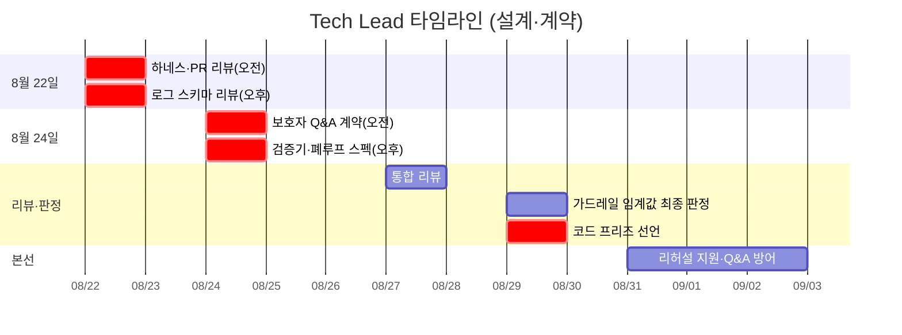

# Tech Lead 개별 타임라인 (설계·계약 전담)

담당: 신호정 · 역할 정의: [역할_가이드/02-테크리드.md](../역할_가이드/02-테크리드.md) ·
전체 흐름: [00-overall.md](00-overall.md) · 기준 날짜: [README.md](README.md)

**코드를 쓰지 않는 포지션입니다.** 산출물은 스펙과 판정입니다.

이 타임라인의 형태는 **앞쪽에 스펙 3건을 몰아 내리고, 뒤는 리뷰·판정으로 전환**하는 것입니다
(→ [ADR-0002](../adr/0002-frontloaded-tech-lead.md)의 초반 집중 모델이 압축 구간에서도 그대로 적용됩니다).

> **2026-08-21 개정 — 작업 구간 8/22~9/2 확정 · 일요일 휴무 반영.**
> **8/21(금)에는 배정이 없고**, 8/23·8/30이 휴무가 되면서 구현 구간이 10일 → **7일**로 줄었습니다.
> 이 포지션에서 바뀐 것은 둘입니다.
> ① 스펙 3건이 **8/21·8/22·8/23 사흘 → 8/22(둘)·8/24(하나)** 로 붙었습니다.
> ② **코드 프리즈가 8/30 → 8/29(토)** 로 하루 당겨졌습니다.
> 배경은 [00-overall.md §0](00-overall.md#0-일요일-휴무의-대가--사흘이-사라졌습니다--먼저-읽으세요).

> **2026-08-21 재조정 — 8/22 오전이 이 포지션의 하네스 작업 구간이 됐습니다.**
> 팀 작업이 8/22 오후부터인 이유가 이것입니다. 그래서 배치를 이렇게 바꿨습니다 —
> **8/22 오전** 하네스 작업 + PR #90·#95 리뷰·머지 / **8/22 오후** 로그 스키마 리뷰
> **8/24 오전** 보호자 Q&A 계약 / **8/24 오후** 검증기·폐루프 스펙
> Q&A 계약은 소원 님 추천 3질문(8/24~25)의 선행이라 8/24 오전이면 늦지 않습니다.

**8/22 오후 스키마 리뷰가 이 포지션의 가장 급한 칸입니다.**
소원 님이 4시간 안에 초안부터 확정까지 가야 하므로,
**리뷰가 「설계 논의」가 되면 그날 안에 안 끝나고 팀 전체가 8/24까지 대기합니다.**

## 일자별 배정

| 날짜 | 작업 | 우선순위 | 완료 기준 |
|---|---|---|---|
| `8/22` (토) **오전** | **평가 하네스 작업** · PR #90·#95 리뷰 → 머지 | **P0** | 하네스 착수 + 두 PR 머지 (팀이 오후에 움직일 수 있게) |
| `8/22` (토) **오후** | **이벤트 로그 스키마 리뷰 [당일 필수]** | **P0** | 필드·값 정의 확정 → 그날 안에 전원 공유 |
| `8/23` (일) | **휴무** | — | — |
| `8/24` (월) **오전** | **보호자 Q&A 계약 확정** (`/v1/guardian/{token}/ask`) | **P0** | OpenAPI 반영 + 세 사람 합의 |
| `8/24` (월) **오후** | **검증기 규칙 · 폐루프 로직 스펙 정의** | **P0** | 주장 단위 분해 규칙 + 5단계 상태 전이표 |
| `8/25`~`8/26` | (평가 하네스 작업 — 별도 트랙) | 진행 | — |
| `8/27` (목) 저녁 | 통합 리뷰 — 생성·검증·로그가 계약대로 붙었는지 · **조건부 판정 — 자유질문** | 진행 | 계약 위반 목록 + 수정 요청 + 컷오프 판정 1건 |
| `8/28` (금) 저녁 | **조건부 판정 — SHAP · OSRM** · 프리즈 사전 점검 | **P0** | 컷오프 판정 2건 + 8/29에 자를 항목 목록 |
| `8/29` (토) | 가드레일 임계값 최종 판정 · **코드 프리즈 선언 · 시연 브랜치 고정** | **P0** | 임계값 확정 + 프리즈 태그 + 시연 브랜치, 전 역할 합의 |
| `8/30` (일) | **휴무 (예비일)** | — | 프리즈 미완 시 최후 수단 |
| `8/31` (월) | 리허설 기술 지원 · Q&A 예상질문 정리 | 진행 | 예상질문 답변안 |
| `9/1` (화) | 시연 환경 최종 확인 | 진행 | 이상 없음 확인 |
| `9/2` (수) | 현장 기술 점검 · Q&A 방어 대기 | 발표 | 현장 점검 완료 |

## 날짜가 그 자리에 있는 이유

- **8/22 오후 스키마 리뷰는 반드시 당일** — 로그 API(8/24)가 이것을 기다리고,
  그 API를 세션 로그 답변(8/25)이 다시 기다립니다. **7일짜리 일정에서는 반나절이 이틀이 됩니다.**
  작업 구간이 8/22부터라 **초안을 미리 받아 둘 하루가 없습니다.**
  김소원이 **오후 4시간 안에** 초안을 쓰고 확정까지 가야 하므로,
  **리뷰는 「설계 논의」가 아니라 「범위 확인」이어야 합니다** —
  기존 `SessionStore`에 `events` 배열을 얹는 형태이고 신설이 아니며,
  필드는 `type` · `at` · `payload` 셋을 넘기지 않는다는 선을 먼저 그어 주십시오.
  여기서 설계를 열면 오전 안에 안 끝나고, 그러면 팀 전체가 8/24까지 대기합니다.
- **8/24 오전 Q&A 계약** — `ChatResponse`와 같은 모양으로.
  **「검색 대상은 그 세션의 이벤트 로그 전량이며 세션을 넘지 않는다」** 를 계약에 명문화하면 범위가 흔들리지 않습니다.
  **「sources가 비면 answer는 null」** 불변식도 함께 넣습니다.
  **「기타」 자유질문은 이번 구간에서 빠졌습니다**(8/22 반나절로 소원 님 슬랙이 4h가 되어 SHAP만 남겼습니다).
  계약은 추천 3질문 기준으로 쓰되 **「그 외 입력은 「확인할 수 없습니다」로 폴백」**을 명시하세요.
  그러면 본선 이후 자유질문을 붙일 때도 계약을 다시 쓸 일이 없습니다.
- **8/24 검증기·폐루프 스펙** — 검증기(8/26)와 폐루프(8/28~29)가 이 스펙 위에서 만들어집니다.
  **구현자가 설계까지 하면 7일 일정에서 반드시 어긋납니다.**
- **8/27 통합 리뷰** — 이 시점에 로그 API·생성부·검증기가 다 나와 있습니다.
  계약과 어긋난 곳은 **지금 잡아야** 폐루프(8/28~29)가 그 위에 안전하게 올라갑니다.
- **8/29에 판정과 프리즈가 겹칩니다** — 이전에는 8/29 판정 / 8/30 프리즈로 나뉘어 있었는데,
  8/30이 휴무라 같은 날로 붙었습니다. PM이 돌린 #23·#24 결과를 **오전에** 보고 값을 확정하고,
  **오후에** 프리즈를 선언하는 순서로 하십시오. **실행은 PM, 판단은 Tech Lead.**
- **프리즈 이후** 기능 추가·리팩터링·버전 업 금지, **시연 경로 버그 수정만**.
  코드를 쓰지 않으니 이해관계 없이 판정할 수 있습니다.

## 조건부 — 이제 SHAP 하나입니다

| 조건부 | 담당 | 컷오프 | 자를 때 |
|---|---|---|---|
| **SHAP 기여도** | 김소원 | **8/28 저녁** | 대표 3곳 고정 카드로 축소하거나 삭제 |

**8/22가 반나절이 되면서 조건부가 3건 → 1건으로 줄었습니다.**
자유질문(소원 4h)과 OSRM B안(도혁 8h)은 창구에 자리가 없어 **미리 뺐습니다.**

**컷오프 판정은 이 포지션이 합니다.** 구현자는 자기가 만든 것을 자르기 어렵습니다.
8/28 저녁에 소원 님 상태를 받아 **그 자리에서 판정**하십시오.

> ⚠️ **더 자를 것이 없습니다.** 소원 님 버퍼 0, 은남 님 0.5h입니다.
> 8/22 오후 스키마와 8/24 로그 API 두 칸 중 하나라도 밀리면
> **SHAP이 자동으로 날아가고, 그다음은 P0를 건드려야 합니다.**
> 8/24·8/27 인계일 상태를 매일 저녁 확인하는 것이 이 포지션의 실질적인 일입니다.

**폐루프와 대조 검증기는 자를 수 없습니다.** 이 둘이 기획서의 「에이전틱」·「로그에 없는 사실 0건」 주장의 유일한 증거입니다.

**직접 소관 리스크**: ②(검증기 규칙의 엄밀성 → 「로그에 없는 사실 0건」),
③(폐루프 단계 수 → 지연), ⑧(스펙 3건이 팀 전체의 선행 — **8/22 오후 스키마 리뷰가 그중 가장 급합니다**).
**직접 소관 승인**: D(HyperCLOVA X/NCP — Backend와 공유).
