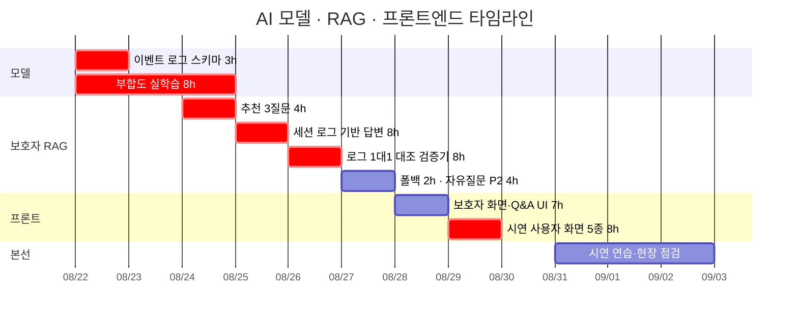

# AI 모델 · RAG · 프론트엔드 개별 타임라인

담당: 김소원 · 역할 정의: [역할_가이드/03-AI-RAG-프론트엔드.md](../역할_가이드/03-AI-RAG-프론트엔드.md) ·
전체 흐름: [00-overall.md](00-overall.md) · 기준 날짜: [README.md](README.md)

> **2026-08-21 개정 — 본선 작전판(2026-08-21) 반영 · 작업 구간 8/22~9/2 확정.**
> **8/21(금)에는 배정이 없고**, 8/23·8/30이 휴무입니다.
> 구현 창구는 **8/22~8/29 중 7일 × 8시간 = 56시간**입니다.
> 작전판의 **작업 목록·시간·조건부 구조를 그대로 가져오고, 날짜만 일요일 휴무에 맞춰 다시 놓았습니다.**

## 이 포지션의 숫자 ★

| | 시간 |
|---|---|
| 확정 (P0 + P1) | **48h** |
| 조건부 (P2 2건) | **8h** |
| 구현 창구 | 56h |
| **버퍼** | **0h** |

**조건부 2건을 둘 다 넣으면 여유가 정확히 0이 됩니다.**
한 칸이라도 밀리면 둘 중 하나는 자동으로 못 합니다.
**먼저 자를 것은 「기타」 자유질문**입니다 — 추천 3질문 + 「확인할 수 없습니다」 폴백만으로도
「근거 없으면 답하지 않는다」는 구조는 증명됩니다. SHAP은 시연 하이라이트라 뒤에 둡니다.

## 일자별 배정 — 시간까지

| 날짜 | 항목 | 등급 | 시간 | 끝났다고 말할 수 있는 기준 |
|---|---|---|---|---|
| `8/22` 토 오전 | **이벤트 로그 스키마** | **P0** | 3h | 필드·이벤트 타입·예시 3건이 `packages/contracts`에 커밋. **좌표 필드 없음** |
| `8/22` 토 오후 | 부합도 모델 실학습 ① | **P0** | 5h | — |
| `8/23` 일 | **휴무** | — | — | — |
| `8/24` 월 | 부합도 실학습 ② **완료** | **P0** | 3h | `summary.json` 레포 커밋 + 모델 파일 1개 + recall·lift 수치 1세트 |
| `8/24` 월 | **추천 3질문** | **P0** | 4h | 3개 질문에 로그 근거로 답하고, 응답에 **근거 이벤트 ID가 실림** |
| `8/25` 화 | **세션 로그 기반 답변** | **P0** | 8h | 검색 대상이 행동요령 코퍼스 → **이벤트 로그로 교체 완료** |
| `8/26` 수 | **로그 1:1 대조 검증기** | **P0** | 8h | 「로그에 없는 사실이 섞인 응답 0건」이 **채점 스크립트로 측정됨** |
| `8/27` 목 | 「확인할 수 없습니다」 폴백 | **P0** | 2h | 범위 밖 질문 5개가 전부 폴백으로 떨어짐 |
| `8/27` 목 | **보호자 RAG 자유질문** | **P2** | 4h | **컷오프 8/27.** 이날 저녁에 판단해 안 되면 자르고 PM에게 통보 |
| `8/28` 금 | 보호자 화면 + Q&A UI | P1 | 7h | 타임라인 + 질문 3개 + 답변 + 근거 이벤트 + **차단 사례 한 줄** |
| `8/28` 금 저녁 | **SHAP 기여도** | **P2** | 4h | **컷오프 8/28 저녁.** 8/29는 시연 화면이 8h를 다 씁니다 |
| `8/29` 토 | **시연 사용자 화면 5종** | **P0** | 8h | 새 라우트에서 5화면이 돌아감. **기존 화면은 건드리지 않음** |
| `8/30` 일 | **휴무 (예비일)** | — | — | 8/29 미완 시 최후 수단 |
| `8/31` 월 | 리허설 지원 · 데모 시연 연습 | 진행 | — | 리허설 1회 통과 |
| `9/1` 화 | 데모 최종 점검 · 시연 연습 | 진행 | — | 끊김 없는 단일 흐름 확인 |
| `9/2` 수 | 현장 데모 최종 점검 | 발표 | — | 현장 시연 준비 완료 |

> **작전판과 달라진 날짜.** 작전판은 「시연 사용자 화면 5종 8/29~30」·「SHAP 8/28~29」였는데
> **8/30이 휴무**라 시연 화면을 8/29 하루로 당기고, SHAP 컷오프를 **8/29 12:00 → 8/28 저녁**으로 옮겼습니다.
> 8/29는 시연 화면 8h가 하루를 다 씁니다.

## 날짜가 그 자리에 있는 이유

- **8/22 오전 스키마가 전체의 출발점입니다. ★ 이 문서에서 가장 중요한 한 칸.**
  **여섯 칸짜리 가장 긴 사슬의 첫 칸**이고, 도혁 님 로그 API(8/24)가 이것을 기다립니다.
  작업 구간이 8/22부터라 **초안을 전날 저녁에 올려 둘 여유가 없습니다.** 오전 안에 확정까지 가야 합니다.

  **완벽할 필요 없습니다** — 필드 목록 + 이벤트 타입 + 예시 레코드 3건이면 다음 칸이 움직입니다.
  범위를 미리 못박고 시작하십시오:

  1. 기존 `SessionStore`에 **`events` 배열을 얹는 형태**이지 신설이 아닙니다
  2. 필드는 **`type` · `at` · `payload`** 셋을 넘지 않습니다
  3. **좌표 필드는 넣지 않습니다** — 「위치정보 미저장」이 지표입니다
  4. 세션을 넘지 않습니다 — 인덱스도 페이지네이션도 없습니다

- **8/22~24 부합도 실학습** — 라벨(서울시 지정 목록)과 피처(전국 공통 13개) 분리 유지,
  자치구 GroupKFold 공간블록 교차검증.
  **기획서 [표3] 3차의 「아직 측정 전」을 우리 숫자로 바꾸는 작업**이고, 심사위원이 가장 먼저 대조할 칸입니다.
  끝났다는 기준은 **`summary.json`이 레포에 커밋되는 것**입니다 — 커밋 메시지 산문에만 있으면 재현이 안 됩니다.

- **8/25 세션 로그 기반 답변** — 그 세션 로그 전량을 컨텍스트로. **벡터 검색 없습니다.**
  「안전합니다」·「괜찮습니다」는 금지어이고 「무엇이 언제 눌렸다/안 눌렸다」 형태로만.
  Backend 로그 API(8/24) 직후입니다.

- **8/26 검증기** — 문장을 주장 단위로 쪼개 로그와 대조 → **미대응 1건이면 문장 전체 차단.**
  Tech Lead 스펙(8/24) 위에서 만들고, **Backend 폐루프(8/28)가 8/27 저녁에 이것을 받아야 합니다.**
  **이 인계일이 이 포지션의 가장 단단한 마감입니다.**

- **8/27 폴백** — 검증기가 있으면 붙이는 수준(2h)입니다. 전부 차단되면 그게 「확인할 수 없습니다」입니다.
  **별도 폴백 판정기를 만들지 마세요.**

- **8/29가 구현의 끝입니다** — 코드 프리즈 당일. 8/30이 휴무라 8/29를 넘길 수 없습니다.
  **기존 사용자 화면을 고치지 말고 새 라우트를 쓰십시오** — 고치면 24h, 새로 쓰면 8h입니다.

- **8/31~ 시연은 이 포지션이 합니다.** 화면 전환 순서와 말할 것을 몸에 익히세요.
  현장 네트워크가 안 되면 `/mockup` 백업으로 전환합니다.

## 조건부 2건 — 컷오프 시각과 판단 기준

| 항목 | 시간 | 컷오프 | 자를 때 |
|---|---|---|---|
| **「기타」 자유질문** | 4h | **8/27 저녁** | 추천 3질문 + 폴백만으로 구조는 증명됩니다. **먼저 자릅니다** |
| **SHAP 기여도** | 4h | **8/28 저녁** | 시연 하이라이트라 뒤에 둡니다. 자를 때는 **대표 3곳 고정 카드**로 축소하는 선택지도 있습니다 |

**자를 때는 그 자리에서 PM(안은남)에게 통보하십시오.** 발표 대본과 [표3] 문구가 달라집니다.

## 은남 님이 넘겨받은 것 — 이 포지션 소관이지만 지원받는 항목

버퍼가 0이라 프런트엔드 두 건이 PM에게 넘어갔습니다. **인계 대상이지 소원 님 몫이 아닙니다.**

| 항목 | 담당 | 시점 | 이 포지션이 할 일 |
|---|---|---|---|
| 행동 권고 3단계 신호등 UI (4h) | **안은남** | 8/24~25 | 폰 목업 2번 화면 기준. **디자인 결정만 확인** |
| 시연 화면 비주얼·문구 (8h) | **안은남** | 8/28~29 | 은남 님이 비주얼·문구·CCTV 표시, **소원 님은 데이터 연결** |

**직접 소관 리스크**: ⑥(부합도 3차 수치는 아직 실측 전 — 본선까지 자체 실측으로 교체),
②(검증기가 느슨하면 로그에 없는 사실이 보호자에게 전달), ⑧(**버퍼 0**).
**직접 소관 승인**: A(서울 열린데이터광장 대피소·침수예상도·침수흔적도, DEM, 건축물대장),
D(HyperCLOVA X — Tech Lead·Backend와 공유).
