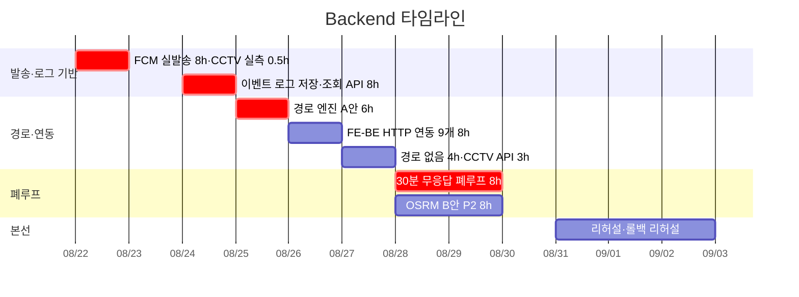

# Backend 개별 타임라인

담당: 김도혁 · 역할 정의: [역할_가이드/04-백엔드.md](../역할_가이드/04-백엔드.md) ·
전체 흐름: [00-overall.md](00-overall.md) · 기준 날짜: [README.md](README.md)

> **2026-08-21 개정 — 본선 작전판(2026-08-21) 반영 · 작업 구간 8/22~9/2 확정.**
> **8/21(금)에는 배정이 없고**, 8/23·8/30이 휴무입니다.
> 구현 창구는 **8/22~8/29 중 7일 × 8시간 = 56시간**입니다.
> **인프라가 PM으로 넘어가면서 배포·롤백·현장 인프라 6h가 빠졌고, 그 자리에 OSRM B안 8h가 조건부로 들어왔습니다.**

## 이 포지션의 숫자 ★

| | 시간 |
|---|---|
| 확정 (P0 + P1) | **45.5h** |
| 조건부 (OSRM B안) | **8h** |
| 합계 | 53.5h |
| 구현 창구 | 56h |
| **버퍼** | **2.5h** |

**인프라 소유는 PM으로 넘어갔지만, 본선 당일 현장 인프라 실행 대응은 이 포지션입니다.**
PM은 무대에 있어 발표 15분 동안 서버를 볼 수 없습니다. **판단은 PM, 손은 Backend.**
셸 권한 2인(안은남·김도혁)이 이것을 전제로 합니다.



## 0. 착수 전 (8/22 이전, 배정 없음)

작업 구간은 **8/22부터**입니다. 아래는 일정에 잡힌 작업이 아니라, 8/25에 막히지 않기 위한 **사전 확인**입니다.

- **OSM 도로망 확보 · 그래프 적재 확인** — 완성이 아니라 **뜨는지**만. 30분이면 됩니다.
  8/25 경로 엔진이 6시간짜리인데 환경 문제로 막히면 그 안에 안 끝납니다.

## 1. 일자별 배정 — 시간까지

| 날짜 | 항목 | 등급 | 시간 | 끝났다고 말할 수 있는 기준 |
|---|---|---|---|---|
| `8/22` 토 | **FCM 실발송 재연결** | **P0** | 8h | **실제 휴대폰에 푸시 도달 캡처 1장.** `firebase-admin` 설치 + `Settings`가 키를 읽음 |
| `8/22` 토 오전 | CCTV 실측 | **P0** | 0.5h | 신림동 반경 CCTV 목록과 스트림 재생 가능 여부를 팀에 공유 |
| `8/23` 일 | **휴무** | — | — | — |
| `8/24` 월 | **이벤트 로그 저장·조회 API** | **P0** | 8h | 세션ID로 이벤트 시퀀스 조회 + **재시작 후에도 남아 있음**. SQLite로 시작 |
| `8/25` 화 | **경로 엔진 A안** (OSMnx + networkx) | **P0** | 6h | 출발지·대피소를 주면 회피 경로 좌표열이 나오고 **최단 경로와 비교됨** |
| `8/26` 수 | FE↔BE HTTP 연동 9개 | P1 | 8h | `http.ts`의 `throw` 9개가 실호출로 교체. **목 어댑터는 백업으로 남김** |
| `8/27` 목 | 「경로 없음」 → 대피소 재선정 폴백 | P1 | 4h | 통과 경로 0이면 다른 대피소로 재선정 → **PM에게 인계** |
| `8/27` 목 | CCTV 좌표·스트림 API | P1 | 3h | 3개소 좌표와 `m3u8` 주소를 경로 응답에 실어 보냄. **화면 표시는 은남 님** |
| `8/28`~`8/29` | **30분 무응답 폐루프** | **P0** | 8h | 무응답 시 2차 발송이 나가고 로그에 남음 + **30분→30초 시연 플래그** |
| `8/28`~`8/29` | **OSRM B안 교체 시도** | **P2** | 8h | **판정 8/28 18:00.** 폐루프가 안 끝났으면 그 자리에서 포기하고 A안으로 프리즈 |
| `8/29` 토 | (배포는 PM 단독) 셸 권한 1인으로 연락 대기 | — | — | **코드 프리즈** |
| `8/30` 일 | **휴무 (예비일)** | — | — | — |
| `8/31` 월 | 리허설 인프라 지원 · 현장 네트워크 대비 | 진행 | — | 리허설 1회 무중단 |
| `9/1` 화 | **롤백 리허설 (PM과 동반)** · `/mockup` 백업 확인 | **P0** | — | 롤백 1회 실행 + 오프라인 로딩 확인 |
| `9/2` 수 | 현장 인프라 **실행** 대응 대기 (판단은 PM) | 발표 | — | 무중단 대기 |

> **작전판과 달라진 날짜.** 작전판은 「로그 API 8/23」·「경로 A안 8/24」·「FE↔BE 8/25~26」이었는데
> **8/23이 휴무**라 전부 하루씩 뒤로 밀었습니다. 폐루프(8/28~29)와 OSRM 판정 시각은 그대로입니다.

## 2. 날짜가 그 자리에 있는 이유

- **8/22 FCM이 먼저입니다.** `dispatch.py`의 기본 `RecordingDispatcher`는 주석 그대로
  **「records instead of sending」** — 기록만 하고 실제로 보내지 않습니다.
  **「도달 30초」·「2차 발송 100%」 두 지표가 실발송 없이는 측정 자체가 불가능합니다.**

  > ⚠️ **8/22는 8.5h로 하루를 0.5h 넘깁니다.** 우선순위를 이렇게 두십시오 —
  > **① 실기기 도달 캡처 1장**(이것만 되면 M1 측정이 성립) → ② CCTV 실측 30분.
  > VAPID 키와 서비스 계정 JSON은 이미 발급돼 있으니(`기존_자산_내역.md` 7절) **찾는 데 시간을 쓰지 마세요.**

- **8/22 CCTV 실측 30분** — 구현이 아니라 **확인**입니다. 결과가 8/27 API 작업의 전제이고,
  「이 구간은 카메라가 없습니다」를 발표에서 **정직하게 말할 근거**가 됩니다.

- **8/24 로그 API** — 스키마(8/22 오전)대로 `SessionStore` 확장.
  엔드포인트 2개(기록·조회), **인덱스 없음**, 페이지네이션 없음 — 한 세션 이벤트는 상한 수십 건입니다.
  **끝났다는 기준은 「재시작 후에도 남아 있음」**입니다. 지금은 모든 상태가 프로세스 메모리라 SQLite부터 시작합니다.
  **AI/RAG 세션 로그 답변(8/25)의 선행이고, 이 인계일이 흔들리면 폐루프까지 연쇄로 밀립니다.**

- **8/25 경로 A안 6h** — OSM → **OSMnx + networkx 인메모리 그래프** → 링크에 침수 위험 등급 →
  R2(침수심 0.5~1.0m)·R3(지하차도·하천변) 제거 후 최단.
  **데모 행정동 1곳으로 좁히고 등급은 사전 계산한 정적 표로** 붙이세요.
  레포에 경로 코드가 **0줄**인 상태에서 시작하는 항목입니다.

- **8/26 FE↔BE 연동** — `http.ts` 9개 메서드가 전부 `throw new Error('not wired yet')`이고
  기본값이 `VITE_USE_MOCK=true`입니다. **이걸 안 하면 시연이 목 데이터로 돕니다.**
  같은 출처인지 교차 출처인지가 코드를 가르므로 **ADR-0008 승인이 선행**입니다.
  **목 어댑터는 지우지 말고 백업으로 남기십시오** — 현장 네트워크 장애 시 되돌릴 곳입니다.

- **8/27 「경로 없음」** — 기획서 명시 동작이자 **실패 모드 시연의 네 번째 케이스**이고,
  PM 대본(8/28)의 선행입니다.

- **8/28~29 폐루프** — 4번째 칸이 AI/RAG 검증기(**8/27 인계**), 마지막 칸이 2차 발송(8/22)이라
  **둘 다 끝난 뒤 조립**합니다. 기획서가 「에이전틱」이라 주장하는 근거가 정확히 이 루프입니다.
  **자를 수 없는 항목입니다.** 시연용 30분→30초 플래그를 잊지 마세요.

- **9/1 롤백은 실제로** — PM 절차서대로 되돌려 보세요. 문서만 있고 해본 적 없으면 본선에서 못 씁니다.
  **PM이 무대에 있는 동안 되돌리는 손은 이 포지션입니다.**

## 3. OSRM B안 — 조건부 8h, 판정 8/28 18:00

인프라 6h가 빠지면서 자리가 생겨 **되살아난 항목**입니다. 성공하면 기획서 문구를 그대로 지킬 수 있습니다.

```
osrm-extract (foot 프로파일에 R2/R3를 excludable로)
  → osrm-partition → osrm-customize → osrm-routed --algorithm=MLD
요청: ?exclude=flood_r3
```

> ⚠️ **폐루프(P0)와 같은 이틀을 씁니다.**
> **8/28 18:00에 폐루프가 안 끝났으면 OSRM을 그 자리에서 포기하십시오.**
> P0가 P2에 먹히면 안 됩니다. 포기해도 A안으로 프리즈하면 시연은 그대로 성립합니다.

## 4. 이 포지션의 인계 마감 두 개

| 인계 | 받는 사람 | 마감 | 늦으면 |
|---|---|---|---|
| 이벤트 로그 저장·조회 API | 김소원 | `8/24` 저녁 | 세션 답변(8/25) → 검증기(8/26) → 폐루프(8/28)가 통째로 밀려 **프리즈를 넘깁니다** |
| 「경로 없음」 재선정 · CCTV 좌표·스트림 | 안은남 | `8/27` 저녁 | 실패 모드 대본(8/28)과 시연 화면 CCTV 표시(8/28~29)가 막힙니다 |

**직접 소관 리스크**: ④(특보 API 중단 시 Redis 캐시 폴백), ⑤(지오코딩·DEM 실패 → 「판정 불가」),
③(FCM 실발송이 있어야 도달 속도 측정 성립), ⑧(로그 API 인계가 양쪽 대기를 만듦).
**직접 소관 승인**: A(공공 Open API), B(카카오맵·행정동 코드표), C(FCM — 팀 계정 소유·HTTPS 배포처),
D(AWS·NCP 계정 — PM 소관, 확인만).
