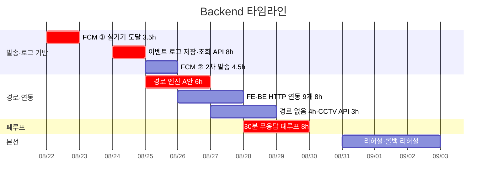

# Backend 개별 타임라인

담당: 김도혁 · 역할 정의: [역할_가이드/04-백엔드.md](../역할_가이드/04-백엔드.md) ·
전체 흐름: [00-overall.md](00-overall.md) · 기준 날짜: [README.md](README.md)

> **2026-08-21 개정 — 본선 작전판(2026-08-21) 반영 · 작업 구간 8/22 ~ 9/2 확정.**
> **8/21(금)에는 배정이 없고**, 8/23·8/30이 휴무입니다.
> **8/22는 오후 4시간뿐**(오전은 Tech Lead 하네스 작업)이라 구현 창구는 **52시간**입니다.
> 인프라가 PM으로 넘어가면서 배포·롤백·현장 인프라 6h가 빠졌습니다.
>
> **⚠️ OSRM B안(8h)은 이번 구간에서 뺍니다.** 8/22 반나절로 버퍼가 6.5h가 되어 8h가 들어가지 않습니다.
> 조건부로 남겨 두면 같은 이틀을 쓰는 **폐루프(P0)를 잡아먹으므로** 아예 제외했습니다 — 3절 참조.

## 이 포지션의 숫자 ★

| | 시간 |
|---|---|
| 확정 (P0 + P1) | **45.5h** |
| 조건부 | **없음** |
| 구현 창구 | **52h** (8/22는 오후 4h) |
| **버퍼** | **6.5h** — 세 사람 중 유일한 여유 |

**인프라 소유는 PM으로 넘어갔지만, 본선 당일 현장 인프라 실행 대응은 이 포지션입니다.**
PM은 무대에 있어 발표 15분 동안 서버를 볼 수 없습니다. **판단은 PM, 손은 Backend.**
셸 권한 2인(안은남·김도혁)이 이것을 전제로 합니다.



## 0. 착수 전 (8/22 이전, 배정 없음)

작업 구간은 **8/22부터**입니다. 아래는 일정에 잡힌 작업이 아니라, 8/25에 막히지 않기 위한 **사전 확인**입니다.

- **OSM 도로망 확보 · 그래프 적재 확인** — 완성이 아니라 **뜨는지**만. 30분이면 됩니다.
  8/25 경로 엔진이 6시간짜리인데 환경 문제로 막히면 그 안에 안 끝납니다.

## 1. 일자별 배정 — 시간까지

| 날짜 | 항목 | 등급 | 시간 | 끝났다고 말할 수 있는 기준 |
|---|---|---|---|---|
| `8/22` 토 **오후** | **FCM ① 실기기 도달** ★ | **P0** | 3.5h | **실제 휴대폰에 푸시 도달 캡처 1장.** `firebase-admin` 설치 + `Settings`가 키를 읽음. **4시간 안에 여기까지만 가면 M1 측정이 성립합니다** |
| `8/22` 토 오후 | CCTV 실측 | **P0** | 0.5h | 신림동 반경 CCTV 목록과 스트림 재생 가능 여부를 팀에 공유 |
| `8/23` 일 | **휴무** | — | — | — |
| `8/24` 월 | **이벤트 로그 저장·조회 API** ★ | **P0** | 8h | 세션ID로 이벤트 시퀀스 조회 + **재시작 후에도 남아 있음**. SQLite로 시작 → **김소원 인계 (마감)** |
| `8/25` 화 | FCM ② 2차 발송 경로 | **P0** | 4.5h | 보호자 2차 발송 성공률 측정 가능 |
| `8/25` 화 | 경로 엔진 A안 착수 | **P0** | 3.5h | — |
| `8/26` 수 | **경로 A안 완료** · FE↔BE 착수 | **P0** / P1 | 2.5h + 5.5h | 출발지·대피소를 주면 회피 경로 좌표열이 나오고 **최단 경로와 비교됨** |
| `8/27` 목 | **FE↔BE 완료** · 「경로 없음」 폴백 · CCTV API 착수 | P1 | 2.5h + 4h + 1.5h | `http.ts`의 `throw` 9개가 실호출로 교체 → **PM 인계** |
| `8/28` 금 | **CCTV API 완료** · 폐루프 ① | P1 / **P0** | 1.5h + 6.5h | 3개소 좌표와 `m3u8`을 경로 응답에 실어 보냄 |
| `8/29` 토 | **폐루프 ② 완료** · 여유 6.5h | **P0** | 1.5h | 무응답 시 2차 발송이 나가고 로그에 남음 + **30분→30초 시연 플래그**. **코드 프리즈** |
| `8/30` 일 | **휴무 (예비일)** | — | — | — |
| `8/31` 월 | 리허설 인프라 지원 · 현장 네트워크 대비 · **리허설 뒤 미사용 보호자 기기 등록 정리** | 진행 | — | 리허설 1회 무중단. `DELETE /v1/guardian/{token}/device`로 리허설 잔여 등록 삭제 - 남으면 9/2 아침 확인이 거짓 양성을 놓침 |
| `9/1` 화 | **롤백 리허설 (PM과 동반)** · `/mockup` 백업 확인 | **P0** | — | 롤백 1회 실행 + 오프라인 로딩 확인 |
| `9/2` 수 | 현장 인프라 **실행** 대응 대기 (판단은 PM) · **아침 보호자 폰 데모 발송 실행** | 발표 | — | 무중단 대기. `/g/` 갱신 뒤 **데모 발송을 실행해 그 폰에 알림이 실제로 뜨는지 확인**([ADR-0015](../adr/0015-guardian-device-registration.md) 결과 절) - PM이 무대에 있는 동안 폰을 들고 있는 손은 이 포지션 |

> **8/24 로그 API를 통으로 지켰습니다.** 8/22가 반나절이 되면서 FCM 잔여분이 밀렸는데,
> 그걸 8/24에 붙이면 **로그 API 인계가 8/25로 밀려 소원 님 이후가 통째로 무너집니다.**
> 그래서 **FCM을 ①실기기 도달(8/22) / ②2차 발송(8/25)로 쪼개고, 8/24는 로그 API만** 넣었습니다.
> 2차 발송은 폐루프(8/28)까지만 되면 되므로 8/25로 밀려도 안전합니다.

## 2. 날짜가 그 자리에 있는 이유

- **8/22 FCM이 먼저입니다.** `dispatch.py`의 기본 `RecordingDispatcher`는 주석 그대로
  **「records instead of sending」** — 기록만 하고 실제로 보내지 않습니다.
  **「도달 30초」·「2차 발송 100%」 두 지표가 실발송 없이는 측정 자체가 불가능합니다.**

  > ⚠️ **8/22 오후에 주어진 시간은 4시간뿐입니다.** 8시간짜리 FCM 작업을 둘로 쪼갰습니다 —
  > **① 실기기 도달(3.5h, 8/22)** / ② 2차 발송 경로(4.5h, 8/25).
  > **오늘 안에 「휴대폰에 푸시가 떴다」 캡처 한 장까지 가면 성공입니다.** 그것만으로 M1 측정이 성립합니다.
  > VAPID 키와 서비스 계정 JSON은 이미 발급돼 있으니(`기존_자산_내역.md` 7절) **찾는 데 시간을 쓰지 마세요.**

- **8/22 오후 CCTV 실측 30분** — 구현이 아니라 **확인**입니다. 결과가 8/27 API 작업의 전제이고,
  「이 구간은 카메라가 없습니다」를 발표에서 **정직하게 말할 근거**가 됩니다.

- **8/24 로그 API — 이 날은 이것만 합니다.** 스키마(8/22 오후)대로 `SessionStore` 확장.
  엔드포인트 2개(기록·조회), **인덱스 없음**, 페이지네이션 없음 — 한 세션 이벤트는 상한 수십 건입니다.
  **끝났다는 기준은 「재시작 후에도 남아 있음」**입니다. 지금은 모든 상태가 프로세스 메모리라 SQLite부터 시작합니다.
  **AI/RAG 세션 로그 답변(8/25)의 선행이고, 이 인계일이 흔들리면 폐루프까지 연쇄로 밀립니다.**

- **8/25 ~ 26 경로 A안 6h** — OSM → **OSMnx + networkx 인메모리 그래프** → 링크에 침수 위험 등급 →
  R2(침수심 0.5 ~ 1.0m)·R3(지하차도·하천변) 제거 후 최단.
  **데모 행정동 1곳으로 좁히고 등급은 사전 계산한 정적 표로** 붙이세요.
  레포에 경로 코드가 **0줄**인 상태에서 시작하는 항목입니다.

- **8/26 ~ 27 FE↔BE 연동** — `http.ts` 9개 메서드가 전부 `throw new Error('not wired yet')`이고
  기본값이 `VITE_USE_MOCK=true`입니다. **이걸 안 하면 시연이 목 데이터로 돕니다.**
  같은 출처인지 교차 출처인지가 코드를 가르므로 **ADR-0008 승인이 선행**입니다.
  **목 어댑터는 지우지 말고 백업으로 남기십시오** — 현장 네트워크 장애 시 되돌릴 곳입니다.

- **8/27 「경로 없음」** — 기획서 명시 동작이자 **실패 모드 시연의 네 번째 케이스**이고,
  PM 대본(8/28)의 선행입니다.

- **8/28 ~ 29 폐루프** — 4번째 칸이 AI/RAG 검증기(**8/27 인계**), 마지막 칸이 2차 발송(8/25)이라
  **둘 다 끝난 뒤 조립**합니다. 기획서가 「에이전틱」이라 주장하는 근거가 정확히 이 루프입니다.
  **자를 수 없는 항목입니다.** 시연용 30분→30초 플래그를 잊지 마세요.

- **9/1 롤백은 실제로** — PM 절차서대로 되돌려 보세요. 문서만 있고 해본 적 없으면 본선에서 못 씁니다.
  **PM이 무대에 있는 동안 되돌리는 손은 이 포지션입니다.**

## 3. OSRM B안 — 이번 구간에서 뺍니다 (본선 이후)

인프라 6h가 빠지면서 한 번 되살아났던 항목인데, **8/22가 반나절이 되면서 다시 나갔습니다.**

| | |
|---|---|
| 필요 | 8h |
| 남은 버퍼 | **6.5h** |
| 결론 | **들어가지 않습니다** |

**조건부로도 남기지 않은 이유** — 폐루프(P0)와 같은 이틀(8/28 ~ 29)을 씁니다.
버퍼가 6.5h인 상태에서 조건부로 남겨 두면 **P0를 잡아먹습니다.**
「해보다 안 되면 자른다」가 성립하려면 애초에 들어갈 자리가 있어야 하는데, 없습니다.

**발표에는 지장이 없습니다.** 기획서 주장 —
「OSM 도로망을 그래프로 올려 침수 위험 링크(R2·R3)를 제외한 보행 경로」 —
는 **A안(OSMnx + networkx)으로 그대로 성립합니다.** 엔진만 다릅니다.
**단 기획서에 「OSRM」이 이름으로 두 번 적혀 있습니다** —
[그림 5] 계산 엔진 「침수 회피 경로(OSM+OSRM)」와 3장 핵심기술② 「OSM 도로망을 OSRM 그래프로 올린 뒤」.
**심사위원이 기획서를 펴놓고 물을 수 있으므로 먼저 밝힙니다.**
정정 문구는 [공유_문서/서비스_기획서.md](../공유_문서/서비스_기획서.md) 맨 앞과 3장 정정 박스에 넣어 두었고,
질의응답 답변안은 [01-기획총괄.md 11절](01-기획총괄.md)에 있습니다.

**이 포지션이 답해야 할 한 줄** — 「OSM 도로망에 R0~R3 등급을 붙이고 R2·R3를 제거한 뒤 최단을 고르는 방식과
「경로 없음」 폴백은 기획서 그대로입니다. 계산 엔진만 OSRM에서 networkx로 바뀌었고,
전국 확장 시 OSRM 전환이 로드맵 첫 항목입니다.」

<details>
<summary>본선 이후 참고 — OSRM 전환 절차</summary>

```
osrm-extract (foot 프로파일에 R2/R3를 excludable로)
  → osrm-partition → osrm-customize → osrm-routed --algorithm=MLD
요청: ?exclude=flood_r3
```
</details>

## 4. 이 포지션의 인계 마감 두 개

| 인계 | 받는 사람 | 마감 | 늦으면 |
|---|---|---|---|
| **이벤트 로그 저장·조회 API** | 김소원 | `8/24` 저녁 | 세션 답변(8/25 ~ 26) → 검증기(8/26 ~ 27) → 폐루프(8/28)가 통째로 밀려 **프리즈를 넘깁니다.** 이것 때문에 8/24를 통으로 비웠습니다 |
| 「경로 없음」 재선정 · CCTV 좌표·스트림 | 안은남 | `8/27` 저녁 | 실패 모드 대본(8/28)과 시연 화면 CCTV 표시(8/28 ~ 29)가 막힙니다 |

**직접 소관 리스크**: ④(특보 API 중단 시 Redis 캐시 폴백), ⑤(지오코딩·DEM 실패 → 「판정 불가」),
③(FCM 실발송이 있어야 도달 속도 측정 성립), ⑧(로그 API 인계가 양쪽 대기를 만듦).
**직접 소관 승인**: A(공공 Open API), B(카카오맵·행정동 코드표), C(FCM — 팀 계정 소유·HTTPS 배포처),
D(AWS·NCP 계정 — PM 소관, 확인만).
